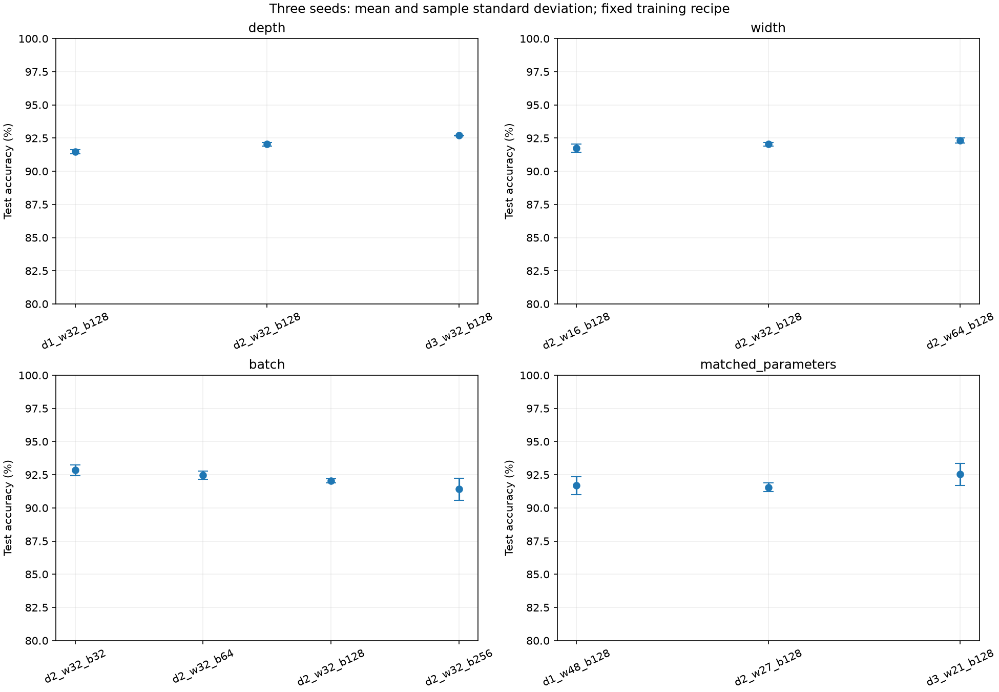
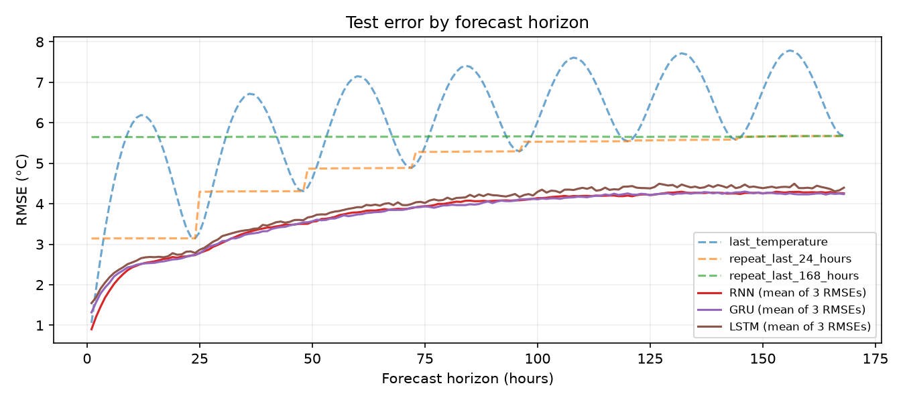

# 深度学习课程实验

使用 PyTorch 完成图像分类与未来一周气温预测，并记录数据处理、控制变量实验、独立测试和代码学习过程。

**已完成：图像分类 48 次正式运行，气温预测 9 次正式运行及 3 个简单基线。** 本仓库包含代码、实验计划、结果汇总、图表、报告与手把手教程。原始数据、训练权重和逐样本预测数组保留在原电脑，未上传。

## 实验内容

| 实验 | 数据与模型 | 研究问题 |
|---|---|---|
| 图像分类 | MNIST、Fashion-MNIST、CASIA-HWDB1.1 自选十类；MLP、LeNet、AlexNet、GoogLeNet、ResNet-18 | 五模型比较；深度、宽度、参数量和 batch size 的影响 |
| 气温预测 | Jena 2009–2016；RNN、GRU、LSTM | 过去 168 小时的 19 个特征，直接预测未来 168 小时温度 |

图像基础比较为 5 模型 × 3 数据集，共 15 次；Fashion-MNIST 控制实验为 11 配置 × 3 种子，共 33 次。汉字采用官方原始数据自选“日、月、山、水、火、木、土、田、人、中”，按书写人隔离，与教师原十类数据包并不完全相同。

## 结果速览

图像基础比较的测试准确率（%，seed 42，统一 AMP 配方）：

| 模型 | MNIST | Fashion-MNIST | HWDB 自选十类 |
|---|---:|---:|---:|
| MLP | 97.62 | 87.92 | 80.57 |
| LeNet | 98.93 | 89.26 | 91.62 |
| AlexNet | 99.38 | 92.15 | 94.97 |
| GoogLeNet | 99.41 | 92.25 | 97.49 |
| ResNet-18 | 99.16 | 92.93 | 97.49 |

来源：[基础结果](reports/amp/baseline_summary.md)。单种子的微小差异不表示稳定优越；控制实验的三种子结果见 [汇总](reports/ablations/summary.md) 和 [逐种子分析](reports/ablations/detailed_analysis.md)。固定宽度时加深的均值提高，但参数量与计算量也同时增加。



气温预测的测试误差（°C，越低越好；网络为三个种子的均值 ± 样本标准差）：

| 方法 | MAE | RMSE |
|---|---:|---:|
| 重复过去一天 | 3.887 | 4.987 |
| RNN | 2.961 ± 0.033 | 3.787 ± 0.051 |
| GRU | 2.965 ± 0.009 | 3.774 ± 0.016 |
| LSTM | 3.077 ± 0.114 | 3.922 ± 0.146 |

来源：[气温独立测试](weather/reports/evaluation/结果汇总.md)。全部使用相同的 6269 个预测起点；窗口重叠，误差不是独立样本。RNN 与 GRU 的差异较小，排序随指标而异；这组结果不代表各架构充分调参后的上限。



## 报告与教程

| 文档 | PDF | 可编辑 Word |
|---|---|---|
| 实验一详细报告 | [阅读](<deliverables/实验一 图像分类与控制变量分析 详细报告.pdf>) | [下载](<deliverables/实验一 图像分类与控制变量分析 详细报告.docx>) |
| 实验二详细报告 | [阅读](<deliverables/实验二 未来一周气温预测 详细报告.pdf>) | [下载](<deliverables/实验二 未来一周气温预测 详细报告.docx>) |
| CNN 与 RNN 手把手教程 | [阅读](deliverables/CNN与RNN训练及独立实验手把手教程.pdf) | [下载](deliverables/CNN与RNN训练及独立实验手把手教程.docx) |

教程包含张量、自动求导、模型形状、训练循环、实际源码分析、调参、数据泄漏、故障排查、断点恢复和实验检查清单。在线文字版：[完整教程](tutorials/CNN与RNN独立实验手把手教程_含源码.md)。部分历史文档中的本地路径记录原环境，新电脑请使用下面的相对路径命令。

## 从小规模练习开始

原实验环境为 Windows、Python 3.12、PyTorch 2.11.0+cu128、RTX 4060 Laptop。原包版本见 [环境快照](environment-lock.txt)。安装时通过 [PyTorch 官方入口](https://pytorch.org/get-started/locally/) 选择适合本机的 torch/torchvision，再安装 `requirements.txt` 中的依赖。

```powershell
git clone https://github.com/arcanechen/deep-learning-experiments.git
cd deep-learning-experiments
python -m venv .venv
.\.venv\Scripts\Activate.ps1
# 先按 PyTorch 官方说明安装适合本机的 torch/torchvision
python -m pip install -r requirements.txt
python -m unittest discover -s tests -v

# CNN 练习先下载 Fashion-MNIST 并建立固定划分
python -c "from data import prepare_split; prepare_split('fashion_mnist')"
python tutorials/train_practice.py --task cnn --device cpu --epochs 2

# 气温练习先下载和预处理 Jena 数据
python weather/prepare_data.py
python tutorials/train_practice.py --task gru --device cuda --epochs 2
python tutorials/check_practice.py
```

没有 CUDA 时，将练习命令改为 `--device cpu`。将 `--task gru` 改为 `rnn` 或 `lstm` 可以练习其他循环网络。练习默认使用小子集，保存到 `tutorials/runs/` 的新目录，不计算正式测试集成绩，不实现完整断点续训。四种模型已在原电脑完成小规模运行验证。

## 项目结构

```text
models.py / controlled_cnn.py   图像模型
 data.py / train.py             图像数据与基础训练
 train_ablation.py             控制实验与断点训练
 evaluate*.py                  独立评价
 tests/                        模型、数据和恢复检查
 weather/                      气温数据、循环模型、训练与评价
 reports/                      图像指标、实验设计与图表
 deliverables/                 两份报告和一份教程
 tutorials/                    可运行学习练习
 docs/                         数据来源、学习记录与复现说明
```

## 正式实验与复现边界

- [数据获取、正式运行与 GitHub 更新方法](docs/复现与托管说明.md)
- [图像模型实现与适配](docs/模型实现说明.md)
- [HWDB 官方来源](docs/HWDB官方数据来源.md) 与 [十类选择说明](docs/HWDB十类子集说明.md)
- [气温数据处理与实验协议](weather/README.md)
- [图像基础核验](reports/amp/baseline_verification.json)、[控制实验核验](reports/ablations/verification.json)、[气温核验](weather/reports/evaluation/verification.json)

正式实验采用训练/验证/测试分离，以验证损失选模，测试不参与调参。数据、源码与配置指纹用于保护断点；Git 不自动转换源码换行。随机种子不能保证跨硬件和库版本逐位一致。冻结计划中保留的“训练前”状态字段属于历史设计，实际完成情况以结果汇总为准。

仓库未包含原始数据和断点，因此从新克隆目录不能直接加载原模型推理；需要按来源获取数据并训练。公开托管不代表第三方数据可以任意再分发，相关数据与依赖遵循其提供方条款。本项目尚未选择开源许可证。
