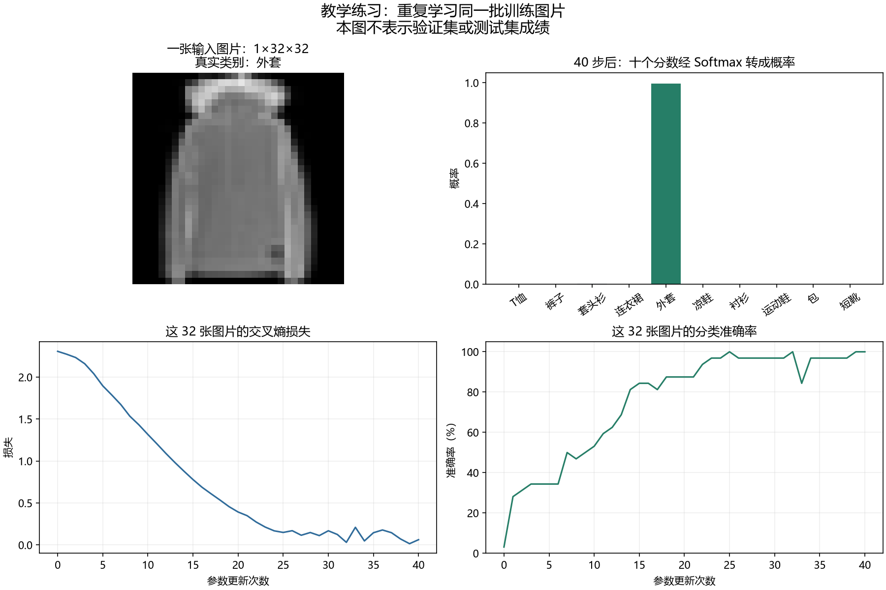

# 第零课：从 Python 到 PyTorch

适合已会 Python、还没独立写过训练循环的你。先理解一小段能运行的程序，再读完整实验。配套代码是项目根目录的 `learn_pytorch.py`，使用 CPU，与正在运行的正式 GPU 实验分开。

## 先运行一次

在 PowerShell 中执行：

```powershell
Set-Location 'D:\深度学习作业'
& 'D:\Anaconda\envs\ai-lab\python.exe' learn_pytorch.py
```

这个练习只取 Fashion-MNIST 训练集中的 32 张图片，重复训练同一个 batch 40 次。它用于观察参数如何变化；即使准确率达到 100%，也只说明模型记住了这 32 张图，不能作为实验成绩。它不会读取测试集或覆盖正式实验结果。

本机已实际运行：第 1、10、20、40 步的这批图片准确率分别是 28.12%、53.12%、87.50%、100.00%，第 40 步损失约 0.0630。原始记录在 `reports/learning/one_batch_demo.json`。不同运行环境可能存在数值差异，理解过程比复刻小数末位更重要。



## 1. Tensor：模型处理的多维数组

Python 列表能存数字；PyTorch 的 `Tensor` 还记录数据类型、形状和所在设备，并支持自动求导。

```python
a = torch.tensor([[1., 2., 3.], [4., 5., 6.]])
print(a.shape)   # torch.Size([2, 3])：2 行 3 列
print(a.dtype)   # torch.float32：每个元素是 32 位浮点数
print(a.device)  # cpu
```

本实验中一批图像的形状是 `[N, C, H, W]`：图片数、通道数、高、宽。`[32,1,32,32]` 表示 32 张单通道的 32×32 灰度图，共 32768 个像素值。第一个 32 和最后两个 32 恰好相同，含义不同。

标签形状是 `[32]`，每个元素是 0—9 的整数。例如标签 9 在 Fashion-MNIST 中表示短靴。标签用 `torch.int64`，送入模型的像素用浮点数。标签不包含在图像通道里。

原始图片为 `[32,1,28,28]` 的 uint8 数组，像素在 0—255。项目的 `preprocess` 将其缩放到 32×32，并按 `(像素/255 - 0.5)/0.5` 映射到 [-1,1]。这使三个数据集采用一致的模型输入约定。

## 2. 参数与梯度：先用一个数字手算

先看只有一个可学习参数 w 的模型：输入是 3，预测值是 `3*w`，希望预测 12。

令损失 `L=(3w-12)²`，初始 `w=2`。预测是 6，损失是 36；梯度为 `dL/dw=2(3w-12)*3=-36`。梯度描述当前位置上，参数微小变化如何影响损失。

```python
w = torch.tensor(2., requires_grad=True)
loss = (3 * w - 12).square()
loss.backward()
print(w.grad)  # -36
with torch.no_grad():
    w -= 0.05 * w.grad
```

这一步按梯度的反方向更新：`w=2-0.05*(-36)=3.8`，新预测为 11.4，新损失约为 0.36。`0.05` 是学习率，控制步子的大小。大网络同样计算损失对各参数的梯度，只是参数更多，求导链条更长。

`backward()` 负责计算梯度，`optimizer.step()` 才负责更新参数。正式代码使用 Adam，它会利用梯度的一阶、二阶矩估计来调整更新，不能把它的更新公式直接等同于上面的简单梯度下降。

## 3. 模型：一串带可学习参数的运算

`nn.Module` 是模型的基类。`__init__` 定义层，`forward` 说明输入按什么顺序经过这些层。调用 `model(images)` 会执行前向传播。

本项目 LeNet 的路径是：

```text
图像 [N,1,32,32]
  → 卷积、ReLU、池化 [N,6,14,14]
  → 卷积、ReLU、池化 [N,16,5,5]
  → 展平 [N,400]
  → 全连接 [N,120] → [N,84] → [N,10]
```

卷积使用可学习的小窗口提取局部特征，同一个卷积核在图像的不同位置共享参数。ReLU 把负值置零，引入非线性；最大池化缩小特征图。展平将每张图片的 `16×5×5=400` 个特征排成一行。

输出 `[N,10]` 中的一行，是一张图片对应十个类别的原始分数（logits）。它们可以是负数，也不要求相加等于 1。

```python
logits = model(images)
predicted = logits.argmax(dim=1)   # 每行分数最高的类别索引，[N]
probabilities = logits.softmax(dim=1)  # 需要显示概率时再计算
```

`dim=1` 是沿类别这一维操作。若误写 `dim=0`，就变成在不同图片之间比较分数，含义完全变了。训练使用 `CrossEntropyLoss(logits, labels)`，不要先对 logits 加 Softmax；交叉熵已经包含相应的对数概率计算。

## 4. 一次训练：五行代码分工明确

```python
model.train()
optimizer.zero_grad(set_to_none=True)
logits = model(images)
loss = criterion(logits, labels)
loss.backward()
optimizer.step()
```

| 代码 | 发生的事 | 观察方法 |
|---|---|---|
| `zero_grad` | 清除上一轮累积的梯度 | 避免意外把多个 batch 的梯度相加 |
| `model(images)` | 用当前参数计算输出 | 打印 logits.shape |
| `criterion(...)` | 将预测和标签转换为标量损失 | 打印 loss.item() |
| `backward()` | 为参数计算梯度 | 查看某层 weight.grad |
| `step()` | 优化器更新参数 | 比较更新前后的 weight |

PyTorch 默认会累加 `.grad`，因此通常每个 batch 开始前都要清除。`model.train()` 用于切换训练模式，并不会自动执行上述五步，也不会直接更新参数。

练习程序会打印第一层卷积的梯度范数、更新前后的最大权重差。你可以直接观察“有了梯度”和“参数真的改变了”是两件事。

## 5. Batch、step、epoch

- batch：一次取出的样本组，这个练习是 32 张。
- step：一次优化器更新。练习默认尝试更新 40 次，每次都使用相同的 32 张。
- epoch：正式训练中完整遍历一次训练集。Fashion-MNIST 的训练部分有 54000 张，batch=128 时，每轮 422 个 batch，最后一个 112 张。

练习中的 40 步不是正式数据集的 40 个 epoch。正式训练的 DataLoader 会逐批遍历全部训练数据，并在每一轮重新打乱训练顺序。

## 6. 验证时为什么需要两个设置

```python
model.eval()
with torch.no_grad():
    logits = model(images)
```

`eval()` 改变 Dropout、BatchNorm 等层的行为；`no_grad()` 关闭这段计算的梯度记录。它们互不替代。基础 LeNet 没有这两种层，但保持这一写法能正确适用于其余模型。

验证时不运行 `backward()` 和 `step()`。训练集用于更新参数；验证集用于按预先约定的规则选权重；测试集用于确定方案后的独立评估。

正式实验还使用 GPU 和自动混合精度（AMP）提升速度。这不改变“输入→预测→损失→梯度→更新”的学习主线。先看懂本练习的 CPU 浮点训练，再阅读 `train.py` 中的 autocast 与 GradScaler。

## 7. 完成标准与小练习

先用自己的话回答，再对照下面的提示：

1. batch 中有 8 张图时，LeNet 输入、输出和标签的形状分别是什么？
2. `loss.backward()` 运行后，模型参数一定改变了吗？
3. 为什么交叉熵需要整数标签，而不是把标签放进图像像素中？
4. 同一 batch 的准确率达到 100%，为什么还不能说明模型识别新衣服的能力？
5. 把 `--steps` 改成 1，与默认 40 步比较损失和预测，写下你观察到的实际变化。

核对提示：第 1 题是 `[8,1,32,32]`、`[8,10]`、`[8]`。第 2 题没有，参数更新由优化器执行。第 3 题中标签提供“正确答案”，本项目使用类别索引形式；它不是模型输入的一部分。第 4 题只测了被重复用于更新参数的训练图片。第 5 题损失并不保证每一步严格下降，应实际观察。

接下来阅读 `docs/第一课_跑通一次图像分类.md`，把练习与完整训练对上；再阅读 `docs/第二课_如何比较模型.md` 学习解释正式结果。
