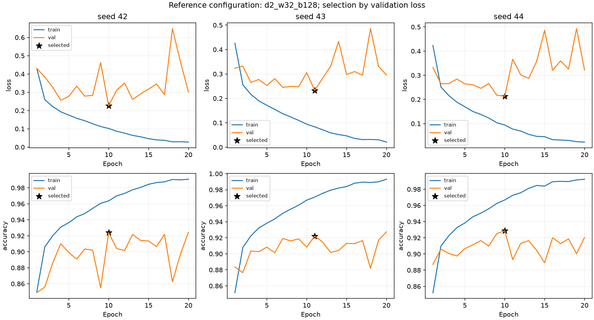

# 控制变量实验：进一步核对与分析素材

全部数值来自已核验的运行记录。逐种子差值用于观察一致性；三次训练不足以支持稳健的显著性检验。

## 逐种子准确率

| 配置 | seed 42 | seed 43 | seed 44 | 平均值 ± 样本 SD |
|---|---:|---:|---:|---:|
| d1_w32_b128 | 91.61% | 91.53% | 91.28% | 91.47 ± 0.17% |
| d1_w48_b128 | 92.45% | 91.17% | 91.42% | 91.68 ± 0.68% |
| d2_w16_b128 | 91.93% | 91.91% | 91.39% | 91.74 ± 0.31% |
| d2_w27_b128 | 91.38% | 91.35% | 91.94% | 91.56 ± 0.33% |
| d2_w32_b32 | 92.49% | 92.75% | 93.27% | 92.84 ± 0.40% |
| d2_w32_b64 | 92.13% | 92.56% | 92.70% | 92.46 ± 0.30% |
| d2_w32_b128 | 92.12% | 91.87% | 92.12% | 92.04 ± 0.14% |
| d2_w32_b256 | 92.28% | 90.65% | 91.30% | 91.41 ± 0.82% |
| d2_w64_b128 | 92.36% | 92.49% | 92.10% | 92.32 ± 0.20% |
| d3_w21_b128 | 93.09% | 92.90% | 91.59% | 92.53 ± 0.82% |
| d3_w32_b128 | 92.72% | 92.68% | 92.67% | 92.69 ± 0.03% |

## depth：相对 d2_w32_b128 的差值

| 配置 | seed 42 | seed 43 | seed 44 | 平均差 |
|---|---:|---:|---:|---:|
| d1_w32_b128 | -0.51 | -0.34 | -0.84 | -0.56 |
| d3_w32_b128 | +0.60 | +0.81 | +0.55 | +0.65 |

## width：相对 d2_w32_b128 的差值

| 配置 | seed 42 | seed 43 | seed 44 | 平均差 |
|---|---:|---:|---:|---:|
| d2_w16_b128 | -0.19 | +0.04 | -0.73 | -0.29 |
| d2_w64_b128 | +0.24 | +0.62 | -0.02 | +0.28 |

## batch：相对 d2_w32_b128 的差值

| 配置 | seed 42 | seed 43 | seed 44 | 平均差 |
|---|---:|---:|---:|---:|
| d2_w32_b32 | +0.37 | +0.88 | +1.15 | +0.80 |
| d2_w32_b64 | +0.01 | +0.69 | +0.58 | +0.43 |
| d2_w32_b256 | +0.16 | -1.22 | -0.82 | -0.63 |

## matched_parameters：相对 d2_w27_b128 的差值

| 配置 | seed 42 | seed 43 | seed 44 | 平均差 |
|---|---:|---:|---:|---:|
| d1_w48_b128 | +1.07 | -0.18 | -0.52 | +0.12 |
| d3_w21_b128 | +1.71 | +1.55 | -0.35 | +0.97 |

差值单位为百分点。同种子不意味着不同结构的初始化参数逐项相同；只是沿用预先配对的种子编号。

## 参数、计算量与实测成本

| 配置 | 卷积层数 | 参数量 | 单图 Conv/Linear MACs | 平均训练+验证秒数 | 平均峰值分配显存 MiB |
|---|---:|---:|---:|---:|---:|
| d1_w32_b128 | 3 | 94,186 | 9,733,376 | 36.0 | 121.0 |
| d1_w48_b128 | 3 | 210,394 | 21,677,952 | 45.6 | 141.3 |
| d2_w16_b128 | 6 | 72,666 | 9,585,280 | 45.3 | 105.9 |
| d2_w27_b128 | 6 | 205,480 | 27,123,768 | 56.3 | 137.1 |
| d2_w32_b32 | 6 | 288,170 | 38,044,928 | 131.9 | 134.5 |
| d2_w32_b64 | 6 | 288,170 | 38,044,928 | 76.3 | 134.5 |
| d2_w32_b128 | 6 | 288,170 | 38,044,928 | 60.0 | 148.1 |
| d2_w32_b256 | 6 | 288,170 | 38,044,928 | 53.8 | 222.6 |
| d2_w64_b128 | 6 | 1,147,722 | 151,587,328 | 118.7 | 235.0 |
| d3_w21_b128 | 9 | 208,309 | 28,644,168 | 72.8 | 140.4 |
| d3_w32_b128 | 9 | 482,154 | 66,356,480 | 78.5 | 177.5 |

MACs 只统计 32×32 单图前向的卷积和全连接乘加，不包含 BN、激活、池化、反向传播、优化器或检查点写盘；不能用它直接推算运行秒数。

## 实际更新与 AMP 跳过次数

| 配置 | 计划更新 | seed 42 跳过 | seed 43 跳过 | seed 44 跳过 |
|---|---:|---:|---:|---:|
| d1_w32_b128 | 8440 | 3 | 4 | 3 |
| d1_w48_b128 | 8440 | 4 | 3 | 4 |
| d2_w16_b128 | 8440 | 3 | 4 | 4 |
| d2_w27_b128 | 8440 | 3 | 3 | 3 |
| d2_w32_b32 | 33760 | 14 | 13 | 13 |
| d2_w32_b64 | 16880 | 6 | 7 | 7 |
| d2_w32_b128 | 8440 | 3 | 2 | 3 |
| d2_w32_b256 | 4220 | 1 | 1 | 1 |
| d2_w64_b128 | 8440 | 2 | 3 | 2 |
| d3_w21_b128 | 8440 | 3 | 3 | 3 |
| d3_w32_b128 | 8440 | 2 | 3 | 4 |

跳过更新说明 GradScaler 没有调用该 batch 的 optimizer.step。已记录的跳过次数属于本轮训练条件，不应隐藏，也不能单独归因于模型容量。

## 训练与验证曲线

下图展示共同参照配置 d2_w32_b128 的三个种子。星号标记最低验证损失的轮次。训练准确率是在一轮内持续更新参数时累计，验证准确率是在轮末计算，两者不是严格同一状态下的泛化差距。

