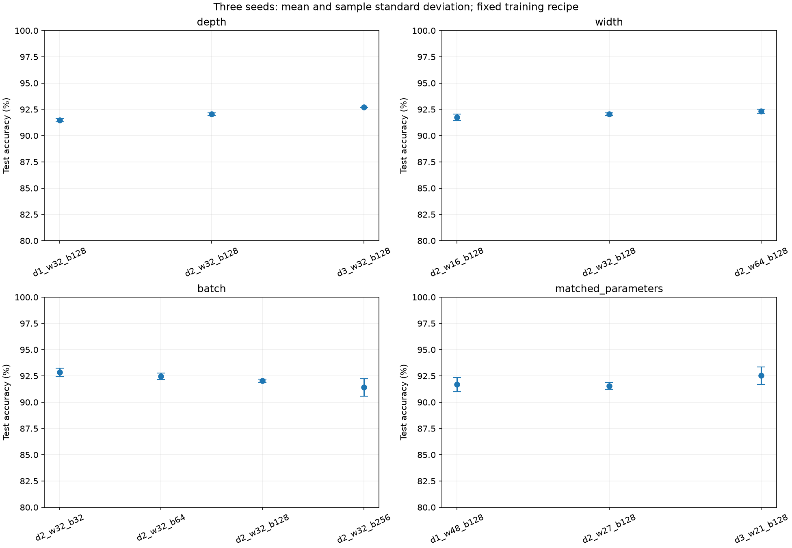

# 实验一：控制变量与重复训练

已核验 33/33 次独立运行；11/11 种配置已具备全部三个种子。

Fashion-MNIST；固定划分 54000/6000/10000；Adam，lr=0.001，无权重衰减，无数据增强；20 epochs；AMP；seed=42/43/44。模型按最低验证损失选取。全部配置预先固定，先完成全部训练，再统一测试。

以下“±”为三个训练种子的样本标准差，不是置信区间；只反映训练随机性，不包含重新抽取训练/测试数据的变化。

## 深度：固定 W=32、batch=128

| 配置 | 参数量 | 测试准确率（均值±SD） | Macro-F1（均值±SD） | 计算秒数（均值） | 实际更新次数（均值） |
|---|---:|---:|---:|---:|---:|
| d1_w32_b128 | 94,186 | 91.47 ± 0.17% | 0.9141 ± 0.0018 | 36.0 | 8436.7 |
| d2_w32_b128 | 288,170 | 92.04 ± 0.14% | 0.9206 ± 0.0009 | 60.0 | 8437.3 |
| d3_w32_b128 | 482,154 | 92.69 ± 0.03% | 0.9268 ± 0.0003 | 78.5 | 8437.0 |

## 宽度/参数量：固定 6 个卷积层、batch=128

| 配置 | 参数量 | 测试准确率（均值±SD） | Macro-F1（均值±SD） | 计算秒数（均值） | 实际更新次数（均值） |
|---|---:|---:|---:|---:|---:|
| d2_w16_b128 | 72,666 | 91.74 ± 0.31% | 0.9168 ± 0.0028 | 45.3 | 8436.3 |
| d2_w32_b128 | 288,170 | 92.04 ± 0.14% | 0.9206 ± 0.0009 | 60.0 | 8437.3 |
| d2_w64_b128 | 1,147,722 | 92.32 ± 0.20% | 0.9233 ± 0.0022 | 118.7 | 8437.7 |

## 批量大小：固定 6 个卷积层、W=32

| 配置 | 参数量 | 测试准确率（均值±SD） | Macro-F1（均值±SD） | 计算秒数（均值） | 实际更新次数（均值） |
|---|---:|---:|---:|---:|---:|
| d2_w32_b32 | 288,170 | 92.84 ± 0.40% | 0.9284 ± 0.0040 | 131.9 | 33746.7 |
| d2_w32_b64 | 288,170 | 92.46 ± 0.30% | 0.9247 ± 0.0030 | 76.3 | 16873.3 |
| d2_w32_b128 | 288,170 | 92.04 ± 0.14% | 0.9206 ± 0.0009 | 60.0 | 8437.3 |
| d2_w32_b256 | 288,170 | 91.41 ± 0.82% | 0.9137 ± 0.0080 | 53.8 | 4219.0 |

## 近似匹配参数量：同时改变深度与宽度

| 配置 | 参数量 | 测试准确率（均值±SD） | Macro-F1（均值±SD） | 计算秒数（均值） | 实际更新次数（均值） |
|---|---:|---:|---:|---:|---:|
| d1_w48_b128 | 210,394 | 91.68 ± 0.68% | 0.9167 ± 0.0065 | 45.6 | 8436.3 |
| d2_w27_b128 | 205,480 | 91.56 ± 0.33% | 0.9154 ± 0.0034 | 56.3 | 8437.0 |
| d3_w21_b128 | 208,309 | 92.53 ± 0.82% | 0.9248 ± 0.0087 | 72.8 | 8437.0 |

## 解释边界

- 固定宽度增加深度时，参数量也会增加；近似匹配参数组可作补充，但其中宽度又同时变化，不能声称完全隔离了所有因素。
- 固定 epoch 改变 batch 时，看到的样本数相同，更新次数不同。BN 的批统计也受 batch 影响。
- 实际更新次数由优化器步骤钩子统计；若 AMP 检测到非有限梯度，会跳过相应更新，不能只拿 batch 数代替。
- 耗时只含成功完成轮次的训练与验证，不含初始化、检查点写盘和被中断的部分轮次。峰值显存为 PyTorch 已分配内存。与上一阶段含存盘的计时口径不同，不直接横比。
- 同一个配置在多个研究组出现时复用同三次运行，不能当成新的独立重复。
- 三个种子不足以证明很小的差异具有统计显著性；这些结论只适用于当前数据划分、模型家族与训练配方。

逐次指标见 individual_runs.csv；核验记录见 verification.json；原始权重、日志与预测在 runs/fashion_ablation_*。
