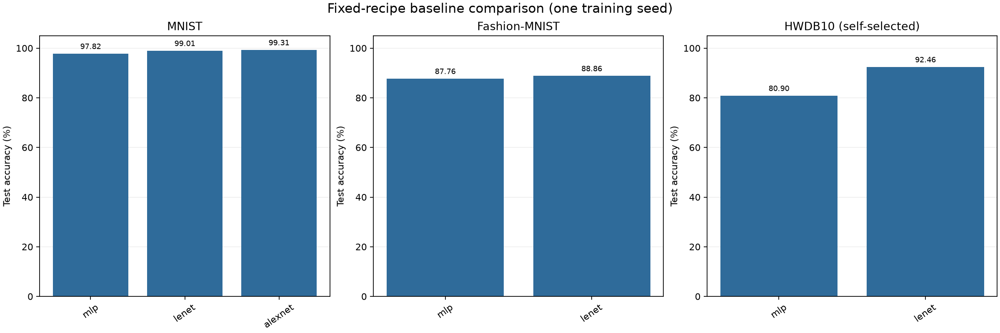

# 实验一：基础模型对比

已完成 7/15 个基础组合，各一个随机种子。全部数值来自本机真实训练与独立测试。

指标表见 [CSV](baseline_summary.csv)，主要误判方向见 [错误分析](baseline_error_analysis.md)。

## 实验协议

- 所有模型从随机初始化训练，固定 seed=42、Adam、lr=0.001、batch=128、精度 fp32，使用 32×32 灰度输入。AMP 表示 FP16 自动混合精度及梯度缩放，参数与优化器状态仍保持 FP32；验证与测试也使用同一 autocast 设置。
- MNIST 和 Fashion-MNIST 训练 10 轮；HWDB10 训练 50 轮。同一数据集内部预算相同，跨数据集的训练耗时不可直接比较。
- 以最低验证交叉熵选权重，再对相应测试集评估一次；没有依据测试结果调整本轮配置。
- MNIST 分层抽样逐类取整后为 54001/5999/10000；Fashion-MNIST 为 54000/6000/10000；HWDB10 为 2159/239/597。
- HWDB10 为官方数据自行选择的十类，按书写人划分，不是课件原始十类子集。

## 实测结果

| 数据集 | 模型 | 参数量 | 选中轮数 | 验证准确率 | 测试准确率 | Macro-F1 |
|---|---|---:|---:|---:|---:|---:|
| mnist | mlp | 296,586 | 10 | 97.62% | 97.82% | 0.9781 |
| mnist | lenet | 61,706 | 10 | 98.60% | 99.01% | 0.9900 |
| mnist | alexnet | 57,022,154 | 10 | 98.93% | 99.31% | 0.9931 |
| fashion_mnist | mlp | 296,586 | 7 | 88.70% | 87.76% | 0.8757 |
| fashion_mnist | lenet | 61,706 | 8 | 89.95% | 88.86% | 0.8895 |
| hwdb10 | mlp | 296,586 | 44 | 82.85% | 80.90% | 0.8076 |
| hwdb10 | lenet | 61,706 | 28 | 93.31% | 92.46% | 0.9245 |

## 训练过程：最佳轮次与最后一轮

| 数据集 | 模型 | 最低验证损失 | 最后一轮验证损失 | 最后一轮训练准确率 | 最后一轮验证准确率 |
|---|---|---:|---:|---:|---:|
| mnist | mlp | 0.0822 | 0.0822 | 98.34% | 97.62% |
| mnist | lenet | 0.0439 | 0.0439 | 99.42% | 98.60% |
| mnist | alexnet | 0.0332 | 0.0332 | 99.09% | 98.93% |
| fashion_mnist | mlp | 0.3110 | 0.3446 | 90.55% | 87.90% |
| fashion_mnist | lenet | 0.2882 | 0.2965 | 91.34% | 89.12% |
| hwdb10 | mlp | 0.4401 | 0.4520 | 88.33% | 82.85% |
| hwdb10 | lenet | 0.2419 | 0.2797 | 99.86% | 94.14% |

最后一轮不一定是选中轮次。训练准确率是在一轮内参数持续更新时累计的，验证准确率使用轮末固定权重；对于 Dropout/BN 模型还存在训练/评估模式差异，所以这个差距不能单独视为纯粹的泛化差距。验证损失回升需要结合完整曲线判断。

## 参数与计算量

| 模型 | 参数量 | 单张图像 Conv/Linear MACs |
|---|---:|---:|
| mlp | 296,586 | 296,192 |
| lenet | 61,706 | 416,520 |
| alexnet | 57,022,154 | 850,804,736 |
| googlenet | 5,601,322 | 1,449,863,168 |
| resnet18 | 11,172,810 | 554,243,072 |

这些数值来自实际适配模型的 32×32 输入，不是原始 ImageNet 模型的论文数值。MACs 只统计卷积和全连接，不包含 BN、激活、池化、反向传播及优化器，也不等于实测耗时。

GoogLeNet 参数少于 AlexNet，但在本实验的输入与下采样设置下乘加次数更多。卷积核会在多个空间位置重复使用，因此参数量、计算量、显存和速度需要分别观察。

## 本机成本记录（MNIST，同为 10 轮）

| 模型 | 总耗时（秒） | PyTorch 峰值已分配显存（MiB） |
|---|---:|---:|
| mlp | 7.4 | 71.2 |
| lenet | 9.1 | 73.3 |
| alexnet | 406.9 | 1309.8 |

耗时包括训练、验证和运行中的日志/最佳权重保存，不包括数据下载；每项只测一次，可能受系统负载影响。显存只统计 PyTorch 已分配内存，不代表整张 GPU 的占用。完整三套数据的成本记录见 CSV。

## 初步观察

- mnist：本轮已测模型中，alexnet 的测试准确率最高，为 99.31%。这描述本轮结果，不用于重新选模型或调整参数。
  LeNet 相对 MLP 的测试准确率差为 +1.19 个百分点。
- fashion_mnist：本轮已测模型中，lenet 的测试准确率最高，为 88.86%。这描述本轮结果，不用于重新选模型或调整参数。
  LeNet 相对 MLP 的测试准确率差为 +1.10 个百分点。
- hwdb10：本轮已测模型中，lenet 的测试准确率最高，为 92.46%。这描述本轮结果，不用于重新选模型或调整参数。
  LeNet 相对 MLP 的测试准确率差为 +11.56 个百分点。

## 解释边界

这是统一初始配方的比较，不是每个网络经过充分调参后的最优性能。小数据集、大模型和相同学习率的组合可能欠拟合、过拟合或优化不稳定，需要结合训练与验证曲线解释。主对比采用 AMP 以适应笔记本的算力与显存，早期 FP32 运行保留作独立参考，不能与 AMP 行混成同一精度对比。

不能由不同架构的排序单独推出网络越深越好、参数越多越好等因果结论；这些问题需要同一模型家族中的控制变量实验。当前只有一个训练种子，尚不能说明小幅差异稳定显著。

AMP 主对比中的 Fashion-MNIST / GoogLeNet 曾在完成前中断，原始记录已保留，随后按同一配置从头完成。重跑与中断记录的早期数值存在差异，原因尚未定位，因此不宣称跨进程逐位复现。详情见 [运行记录](../../docs/运行中断与复现记录.md)；未依据测试成绩在两个运行间择优。

HWDB10 只有 597 张测试图片，且按书写人分组。分类准确率的差异应结合错误数、类别混淆、书写人和重复训练分析。不同数据集的任务难度不同，不能把其准确率直接当作模型优劣排名。

## 结果核验与原始记录

汇总程序从逐图预测重新计算准确率、Macro-F1 与混淆矩阵，核对最佳轮数及同一数据集的划分指纹。原始目录列在 baseline_summary.csv 的 run_dir 列，每次运行保留配置、源码副本、训练曲线、权重和错误样例。

## 后续实验

- 在同一 CNN 家族中改变深度和宽度，研究深度与参数量。
- 固定网络改变 batch size，同时记录更新次数和时间。
- 对关键结论进行多个随机种子复跑，报告均值与标准差。

尚未完成的基础组合：mnist/googlenet、mnist/resnet18、fashion_mnist/alexnet、fashion_mnist/googlenet、fashion_mnist/resnet18、hwdb10/alexnet、hwdb10/googlenet、hwdb10/resnet18
