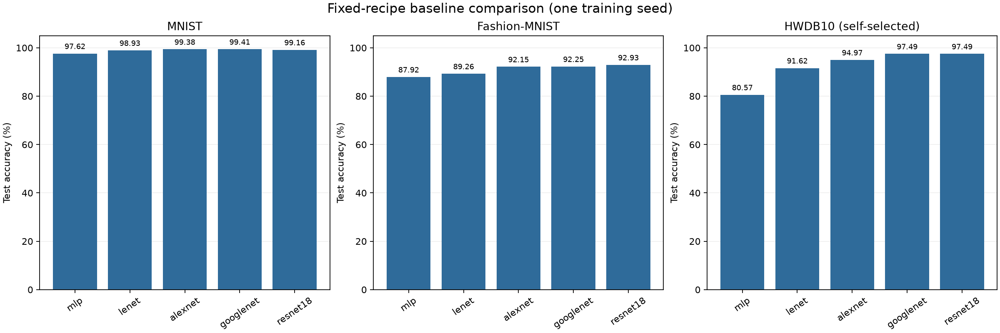
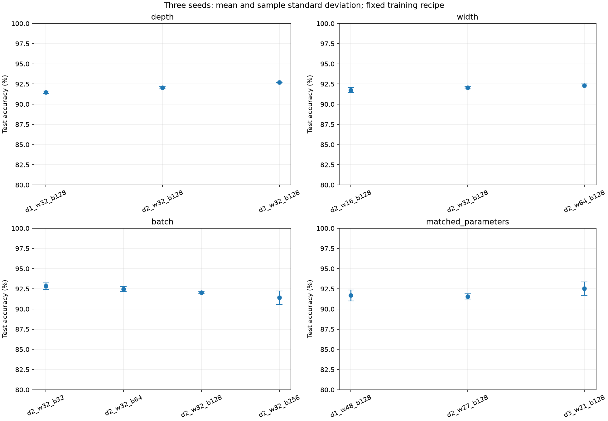
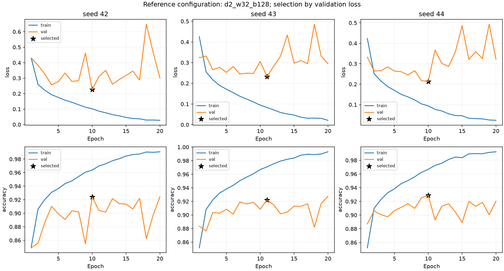

# 实验一：深度神经网络图像分类与控制变量分析

姓名、学号、班级：待填写。

本报告由本机实际运行记录整理。完成 15 组基础模型比较及 33 次控制变量训练；个人学习反思需由学生结合实际理解补充。

## 1. 实验目的

实现 MLP、LeNet、AlexNet、GoogLeNet 和 ResNet-18 的图像分类，比较它们在手写数字、服饰和汉字数据上的效果；通过同一 CNN 家族的控制变量实验，研究深度、宽度/参数量与批量大小的影响；掌握数据划分、前向传播、交叉熵、反向传播、优化器更新、验证选模与独立测试。

## 2. 原理与实现

一批图像表示为形状 [N,1,32,32] 的张量，模型输出 [N,10] 的类别分数 logits。预测取分数最大的类别。训练损失为真实类别的负对数概率，即 L = −log softmax(z)[y]；代码直接将 logits 和整数类别标签传入 CrossEntropyLoss，不额外在损失前执行 Softmax。

每个训练 batch 依次执行清除梯度、前向传播、计算损失、反向传播和优化器更新。验证使用 eval 模式并关闭梯度记录，不更新参数。eval 与 no_grad 的作用不同：前者影响 Dropout/BN 行为，后者影响梯度记录。

五个基础模型均从随机初始化开始，不使用预训练权重。实际实现是适配灰度小图的版本，不能将效果直接当成原始 ImageNet 论文网络的复现结果。

| 模型 | 本实验的实际结构或修改 |
|---|---|
| MLP | 展平后 1024→256→128→10，隐藏层 ReLU |
| LeNet | 两个 5×5 卷积（6/16 通道）、ReLU 与最大池化；400→120→84→10 全连接 |
| AlexNet | 首层改为灰度 3×3、stride=1，移除入口最大池化；保留大尺寸全连接层；固定 7→6 特征图平均池化以支持严格确定性反向传播 |
| GoogLeNet | 灰度 3×3 入口，移除前两个最大池化，关闭辅助分类器与 RGB 专用变换；保留 torchvision 的 Inception 与 BN；branch3 的空间卷积实际为 3×3 |
| ResNet-18 | 首层改为灰度 3×3、stride=1，移除入口最大池化；保留四个残差阶段 |

MLP 将像素直接展平；卷积利用局部连接与空间上的权重共享。残差块通过跳跃连接传递特征。模型间同时存在多项结构差异，因此不能把基础对比的成绩差异单独归因于层数或参数量。完整结构见 [模型实现说明](../docs/模型实现说明.md)。

## 3. 数据与实验条件

| 数据集 | 训练 | 验证 | 测试 | 划分方式 |
|---|---:|---:|---:|---|
| MNIST | 54001 | 5999 | 10000 | 原训练集逐类固定分层，逐类取整；原测试集保留 |
| Fashion-MNIST | 54000 | 6000 | 10000 | 固定分层划分；原测试集保留 |
| CASIA-HWDB1.1 自选十类 | 2159 | 239 | 597 | 216/24/60 位书写人互不重叠 |

MNIST/Fashion-MNIST 的划分种子为 2026，与模型训练种子分开。汉字类别在查看模型效果前固定为“日、月、山、水、火、木、土、田、人、中”。这些数据来自 CASIA 官方原始 GNT 包，保留了官方训练/测试书写人边界，避免同一书写人的风格泄漏到不同集合。

**与课件数据的差异：**汉字使用官方自行选类子集，不是老师原十类包，数量也不是原包的 2382/601。汉字原图保持比例并居中，缓存为 64×64，模型入口再统一到 32×32；这与课件示例的直接 64×64 处理有差异。报告中的结果只适用于这里明确记录的划分和预处理。

全部图像采用固定像素变换：除以 255，双线性缩放为 32×32（antialias=True），再按 (x−0.5)/0.5 映射到 [−1,1]；不从测试集估计归一化统计量。无数据增强。原始数据校验、样本来源和汉字缓存内容已核对。

硬件为 NVIDIA GeForce RTX 4060 Laptop GPU；Python 3.12.14，PyTorch 2.11.0+cu128，torchvision 0.26.0+cu128，CUDA 12.8。

采用 CUDA 自动混合精度：部分运算为 FP16，参数与 Adam 状态保持 FP32，使用 GradScaler 缩放梯度。验证、测试使用同一 autocast 精度设置。早期 FP32 练习单独保留，不混入主比较。

## 4. 基础模型对比

固定 Adam、lr=0.001、无权重衰减、batch=128、seed=42。MNIST/Fashion-MNIST 训练 10 轮，HWDB10 训练 50 轮。以最低验证交叉熵选择权重，再进行独立测试。相同数据集内各模型预算相同；跨数据集的 epoch 数不等于相同更新次数。

| 模型 | 参数量 | MNIST Accuracy | Fashion-MNIST Accuracy | HWDB10 Accuracy |
|---|---:|---:|---:|---:|
| MLP | 296,586 | 97.62% | 87.92% | 80.57% |
| LeNet | 61,706 | 98.93% | 89.26% | 91.62% |
| AlexNet | 57,022,154 | 99.38% | 92.15% | 94.97% |
| GoogLeNet | 5,601,322 | 99.41% | 92.25% | 97.49% |
| ResNet-18 | 11,172,810 | 99.16% | 92.93% | 97.49% |

本轮 LeNet 在三个数据集上均优于 MLP，同时参数量更少，说明参数数量不能单独决定识别性能。卷积的局部连接和共享权重提供了适合图像的结构约束，但这里没有单独隔离所有机制，不能把改进全部归因于某一项设计。

MNIST 上 GoogLeNet 与 AlexNet 的准确率只相差 0.03 个百分点，即 3 张图片；这是单个训练种子的观察，不足以证明稳定优势。汉字上 GoogLeNet 与 ResNet-18 均为 97.49%，各错 15 张，但错误分布及 Macro-F1 不完全相同。

模型参数量不等于计算量：本实验 GoogLeNet 参数少于 AlexNet，但因实际下采样配置与卷积的空间复用，单张小图的卷积/全连接乘加次数更多。完整 F1、验证轮次、耗时、显存和错误方向见 [基础汇总](amp/baseline_summary.md) 与 [错误分析](amp/baseline_error_analysis.md)。

## 5. 控制变量实验设计

固定 Fashion-MNIST、20 epochs、Adam、lr=0.001、无权重衰减和增强、AMP，使用种子 42/43/44。模型有三阶段，通道为 W、2W、4W，每阶段重复 d 次 3×3 卷积+BN+ReLU，再最大池化；最后全局平均池化并分类。深度定义为卷积层数 3d。

研究四个比较组：固定 W 改变深度；固定深度改变 W；固定结构改变 batch；通过补偿宽度近似匹配参数量后比较深度。共享配置只运行一次，去重后共 11 配置 × 3 种子。全部配置在独立测试前固定，并先完成所有训练。

## 6. 控制变量实验结果

下表为测试准确率平均值 ± 三个训练种子的样本标准差。该标准差不是置信区间，不包括重新抽取或划分数据造成的不确定性。

### 6.1 深度

| 配置 | 参数量 | Accuracy（均值 ± SD） | Macro-F1（均值 ± SD） |
|---|---:|---:|---:|
| d1_w32_b128 | 94,186 | 91.47 ± 0.17% | 0.9141 ± 0.0018 |
| d2_w32_b128 | 288,170 | 92.04 ± 0.14% | 0.9206 ± 0.0009 |
| d3_w32_b128 | 482,154 | 92.69 ± 0.03% | 0.9268 ± 0.0003 |

本组均值范围为 91.47%—92.69%；最高均值对应 d3_w32_b128。这仅描述预设比较结果，不据此进一步选择新的测试集最优配置。
固定宽度增加深度时，参数量与计算量也增加，因此这一组并非深度的完全独立效应；需要结合近似匹配组解释。

### 6.2 宽度与参数量

| 配置 | 参数量 | Accuracy（均值 ± SD） | Macro-F1（均值 ± SD） |
|---|---:|---:|---:|
| d2_w16_b128 | 72,666 | 91.74 ± 0.31% | 0.9168 ± 0.0028 |
| d2_w32_b128 | 288,170 | 92.04 ± 0.14% | 0.9206 ± 0.0009 |
| d2_w64_b128 | 1,147,722 | 92.32 ± 0.20% | 0.9233 ± 0.0022 |

本组均值范围为 91.74%—92.32%；最高均值对应 d2_w64_b128。这仅描述预设比较结果，不据此进一步选择新的测试集最优配置。
增加宽度提高参数量，同时改变计算量和中间特征数量。应结合训练拟合程度与验证曲线，讨论容量是否带来稳定收益。

### 6.3 批量大小

| 配置 | 参数量 | Accuracy（均值 ± SD） | Macro-F1（均值 ± SD） |
|---|---:|---:|---:|
| d2_w32_b32 | 288,170 | 92.84 ± 0.40% | 0.9284 ± 0.0040 |
| d2_w32_b64 | 288,170 | 92.46 ± 0.30% | 0.9247 ± 0.0030 |
| d2_w32_b128 | 288,170 | 92.04 ± 0.14% | 0.9206 ± 0.0009 |
| d2_w32_b256 | 288,170 | 91.41 ± 0.82% | 0.9137 ± 0.0080 |

本组均值范围为 91.41%—92.84%；最高均值对应 d2_w32_b32。这仅描述预设比较结果，不据此进一步选择新的测试集最优配置。
固定 20 轮时，batch=32/64/128/256 的计划更新次数为 33760/16880/8440/4220，因此这一组同时反映更新预算与 BN 批统计的变化。实际更新次数另外统计了 AMP 跳过更新的情况。

### 6.4 近似匹配参数量

| 配置 | 参数量 | Accuracy（均值 ± SD） | Macro-F1（均值 ± SD） |
|---|---:|---:|---:|
| d1_w48_b128 | 210,394 | 91.68 ± 0.68% | 0.9167 ± 0.0065 |
| d2_w27_b128 | 205,480 | 91.56 ± 0.33% | 0.9154 ± 0.0034 |
| d3_w21_b128 | 208,309 | 92.53 ± 0.82% | 0.9248 ± 0.0087 |

本组均值范围为 91.56%—92.53%；最高均值对应 d3_w21_b128。这仅描述预设比较结果，不据此进一步选择新的测试集最优配置。
三组参数量最大与最小相差约 2.4%，但宽度也随着深度改变。因此该组缓解容量混杂，仍不能完全隔离深度。

逐种子数值、配对种子差值、计算量与实际更新见 [详细分析素材](ablations/detailed_analysis.md)。三种子曲线见下图：

### 6.5 综合解释

以下结论基于 Fashion-MNIST 上预先固定的 11 种配置、每种 3 个训练种子。准确率都是独立测试集结果；“±”表示三个种子的样本标准差，不是置信区间。这里只解释已经完成的对照，不根据测试成绩继续筛选配置。

#### 深度：固定宽度时，本次增加卷积层数有收益

在 W=32、batch=128 不变时，3、6、9 个卷积层的平均准确率分别为 91.47±0.17%、92.04±0.14%、92.69±0.03%。三个种子中都保持了相同排序；9 层相对 6 层分别提升 0.60、0.81、0.55 个百分点。因此，“在本次固定宽度和训练配方下，较深模型表现更好”有直接证据。

但 3 层增加到 9 层时，参数量也从 94186 增至 482154，约为原来的 5.12 倍；平均训练加验证时间从 36.0 秒增至 78.5 秒。不能把全部收益都归因于深度，也不能据此推断继续加深一定更好。

#### 参数量：大幅增加参数，准确率收益相对有限

固定 6 个卷积层，W=16/32/64 对应的平均准确率为 91.74±0.31%、92.04±0.14%、92.32±0.20%。从 W=16 增加到 64，参数量约增加到原来的 15.8 倍，平均准确率只提高约 0.57 个百分点。

尤其是 W=64 相对 W=32，三个种子的差值分别为 +0.24、+0.62、−0.02 个百分点。较宽模型平均值较高，但并非每一次都更好；其平均计算时间也由约 60.0 秒增至 118.7 秒。评价模型时需要同时考虑效果、波动和成本，不能把参数最多直接当作最优方案。

#### Batch：较小 batch 平均更准，同时用了更多更新

batch=32/64/128/256 的平均准确率为 92.84±0.40%、92.46±0.30%、92.04±0.14%、91.41±0.82%。batch=32 相对 128 在三个种子上都更高，平均提升 0.80 个百分点，但平均训练加验证时间约为 2.20 倍。

这不是只改变了“每次装几张图”的实验：固定 20 epochs 时，batch=32 的计划更新次数为 33760，而 batch=128 为 8440，相差 4 倍；BN 的批统计也受到影响。因此，这组回答的是固定数据遍历预算下的效果和成本，不能将结果简单概括成“小 batch 天生更好”。若要单独研究更新次数，还需要事先设计另一组固定更新预算的对照，本轮没有执行。

batch=256 的波动较大；seed42 为 92.28%，高于相同种子 batch=128 的 92.12%，而另外两个种子更低。这个例子说明为什么不能根据单次运行下结论。

显存记录包含训练和验证的整个轮次。验证始终采用 batch=256，因此它可能给较小训练 batch 的峰值显存形成下限；表中 batch=32 与 64 的峰值相同，不能解释成训练 batch 不影响显存。

#### 参数量匹配：均值优势还需要结合波动解释

参数量约为 20.5—21.0 万的 3/6/9 层模型，平均准确率依次是 91.68±0.68%、91.56±0.33%、92.53±0.82%。9 层的均值最高，但相对 6 层的三个种子差值为 +1.71、+1.55、−0.35 个百分点，方向并不完全一致。因此，这组没有给出“在相近参数量下，增加深度在每个种子都有效”的证据。

同时，这组三个模型的单图卷积/全连接 MACs 分别约为 2168 万、2712 万和 2864 万。参数量相近不代表计算量相同；深度与宽度也同时变化。这些限制应和均值结果一起报告。

#### 曲线：训练拟合更好，验证表现未必继续改善

共同参照模型 d2_w32_b128 的三个种子分别在第 10、11、10 轮取得最低验证损失。之后训练损失整体继续降低，验证损失却出现回升和波动。训练与验证曲线分离提示泛化存在限制；但单凭曲线还不能把每一次波动都唯一归因于过拟合或 BN。

实验按事先约定使用最低验证损失的模型，而不是最后一轮或测试准确率最高的一轮。训练准确率是在一轮中不断变化的参数上累计，验证准确率是轮末固定权重下测得，两者也不能直接当作完全相同状态下的泛化差距。

#### 结论的范围

固定宽度的深度组和 batch=32 相对 128 的对照，在本次三个种子里具有一致方向；宽度增加和参数近似匹配组的优势则并非每个种子都成立。样本标准差来自仅三个训练种子，不足以单独证明统计显著性；同一数据划分也没有反映数据抽样变化。

这些结果适用于本次 Fashion-MNIST 划分、CNN 家族、20 轮 Adam 配方和 AMP 精度，不直接推广到 MNIST、汉字或其他任务。前一阶段经典模型训练预算不同，也不能把两阶段的准确率放在一起宣布某个架构总体最优。

全部数值可在 [逐种子分析](ablations/detailed_analysis.md)、[原始指标](ablations/individual_runs.csv) 和 [核验记录](ablations/verification.json) 中追溯。学习时可以先选一组对照，用自己的话分别写出“观察到了什么、能解释到哪一步、还不能证明什么”。

## 7. 核验、运行问题与局限

- 所有结果均从保存的逐图预测重新核算 Accuracy、Macro-F1 和混淆矩阵，同时核对划分指纹、选中轮次及固定训练预算。
- 基础阶段 Fashion-MNIST / GoogLeNet 中断后按原配方完整重跑，早期数值与中断运行存在差异，原因尚未定位，已保留原始记录；没有按测试成绩在两个运行间择优。
- 控制阶段每轮原子保存完整训练状态，已完成 CPU 精确续训和实际 CUDA 检查点恢复检查。后来队列再次退出，未发现错误日志，原因未确定；已从已保存轮次恢复。不承诺跨驱动、库版本或不同设备的逐位一致。
- 2026-10-31 的 d3_w32_b128 / seed43 在第 15 轮内另遇到 CUDA unknown error，保留了第 14 轮完整检查点，随后用新进程恢复。异步 CUDA 报错的根因尚未确定；原日志已归档，未更改实验配方。
- 基础阶段是每组合单种子；控制阶段为三个种子，且只在 Fashion-MNIST 上开展。不能把控制阶段结论直接推广到所有数据集。
- 基础阶段采用统一起始配方，未为每个架构进行充分超参数搜索；结果不代表各架构的最佳可能性能。
- 控制阶段时间只计成功轮次的训练与验证，不含检查点存盘与中断的半轮；基础阶段含日志/最佳权重保存。两阶段计时口径不同。

## 8. 学习总结与复现

本实验展示了从数据准备到训练、验证选模、测试及分析的完整流程。模型效果需要结合结构、数据规模和训练预算解释。均值、波动、实际更新次数和计算成本应同时报告，不能只挑最高准确率。

个人学习总结：请结合自己实际运行与阅读代码的过程，说明哪些张量形状、梯度更新或曲线现象原先不理解，现在能够解释；不要直接将自动生成的结果整理当成个人学习经历。

复现与源代码见 [项目说明](../README.md)，实时记录见 [进度与续跑](../进度与续跑.md)。初学训练循环见 [第零课](../docs/第零课_从Python到PyTorch.md)，控制实验原理见 [第三课](../docs/第三课_控制变量与断点续训.md)。

## 数据与实现来源

- 课程课件：深度学习实验题目及要求(2).pptx，实验一部分。
- [Fashion-MNIST 官方项目](https://github.com/zalandoresearch/fashion-mnist)。
- [CASIA 官方下载页](https://nlpr.ia.ac.cn/databases/handwriting/Download.html)；源包、哈希与解析详情见 [汉字来源说明](../docs/HWDB官方数据来源.md)。
- 模型实际代码：[models.py](../models.py) 与 [controlled_cnn.py](../controlled_cnn.py)；运行目录包含训练源码副本与配置。

本报告尚需填写学生信息、个人学习总结，并按教师的提交模板调整版式。
