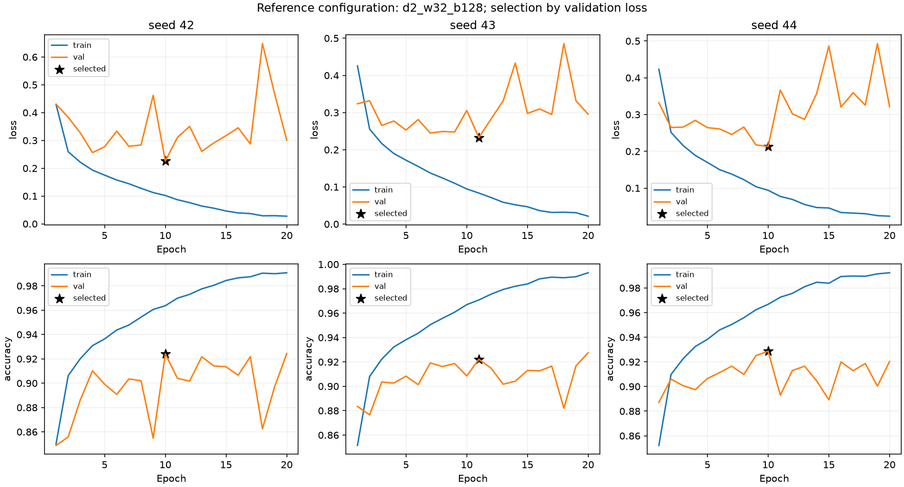
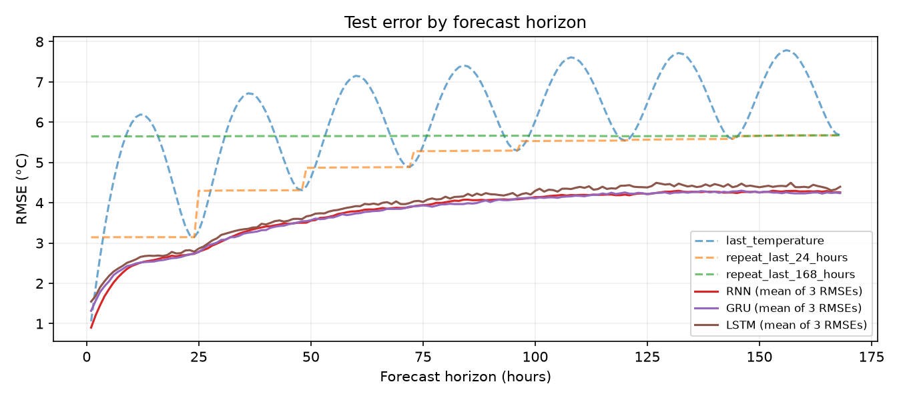

# 从两个课程实验学会独立训练 CNN 与 RNN

适合读者：会 Python，尚需从张量、模型和训练循环开始学习。

配套项目：D:/深度学习作业　编写日期：2026 年 11 月 2 日

## 阅读方法与学习目标

本教程以已经完成的图像分类和气温预测实验为例，帮助你从“能运行代码”进阶到“能解释代码、发现错误、设计可信实验”。读完之后，应能够独立写出数据划分方案、检查张量形状、完成训练和验证、保存与加载模型，并解释结果成立的条件。

教程覆盖个人在单机监督学习实验中应逐项考虑的主要环节。具体业务仍需补充其特有要求，例如医学数据的受试者边界或生产系统的实时性；不能用一张通用清单替代领域判断。这里重点研究图像分类与多步时间序列回归，不把分布式训练或强化学习展开为入门内容。

建议按四个里程碑推进：先完成第 1—2 节并手算一个梯度；再读第 3—7 节跑通 CNN；接着读第 8—11 节跑通循环网络；最后用第 12—17 节设计自己的实验。每次改动之前写下预期，运行之后记录观察。暂时记不住所有 API 没关系，必须先知道每个数据从哪里来、每一维是什么、每个指标怎么算。

正式实验已完成。练习使用 tutorials/train_practice.py，结果写入 tutorials/runs 的新目录，既不覆盖正式权重，也不计算正式测试集成绩。小样本练习的数字只用于理解流程，不能填入已经完成的实验报告。

## 1 先确认环境与文件位置

### 1.1 用正确的 Python 启动

在 PowerShell 执行以下命令。第一行进入项目根目录；第二行只是将解释器路径存入变量，不会创建新环境。后续命令均假设这个窗口仍在该目录。

```powershell
Set-Location 'D:\深度学习作业'
$py = 'D:\Anaconda\envs\ai-lab\python.exe'
$env:PYTHONIOENCODING = 'utf-8'
& $py -c "import torch; print(torch.__version__); print(torch.cuda.is_available())"
```

本项目使用 PyTorch 2.11.0+cu128、RTX 4060 Laptop。你应看到 torch 版本和 CUDA 可用性。版本字符串里有 cu128，不等于所有环境都自动可用；真正应检查当前进程的 torch.cuda.is_available()。若为 False，先确认解释器和驱动，再决定用 CPU 学习；不要在没有证据时反复卸载整个环境。

独立实验开始前还要确认磁盘剩余空间、数据与权重保存位置、电脑供电与散热、预计耗时，以及训练期间是否会休眠。Python 进程存在不等于训练还在前进，应看最新保存轮次和 GPU 状态。不要同时开多份相同的 GPU 训练来“加速”。

### 1.2 找到数据流而不是把文件从头背一遍

| 环节 | CNN 实际代码 | 气温实际代码 |
|---|---|---|
| 数据划分与预处理 | data.py | weather/prepare_data.py |
| 模型定义 | models.py、controlled_cnn.py | weather/weather_model.py |
| 基础训练循环 | train.py 中 run_epoch | weather/train_weather.py 中 epoch |
| 完整断点训练 | train_ablation.py、ablation_common.py | weather/train_weather.py |
| 独立测试 | evaluate.py、evaluate_ablation.py | weather/evaluate_weather.py |
| 初学者练习 | tutorials/train_practice.py 的 cnn 分支 | 同一脚本的 rnn、gru、lstm 分支 |

阅读顺序是 Dataset 给出什么 → DataLoader 拼成什么 → 模型输出什么 → 损失比较什么 → 梯度更新什么 → 验证保存什么。代码入口的 if __name__ == '__main__' 让脚本在直接运行时执行 main，导入其中的类时不会自动启动训练。

## 2 张量与自动求导是共同基础

### 2.1 同时检查形状 类型 和设备

Tensor 是多维数组，同时带有 dtype、device 和梯度信息。把下面片段保存为临时 Python 文件执行，或在 Python 交互环境中逐行输入。

```python
import torch
x = torch.randn(4, 1, 32, 32)
y = torch.tensor([0, 3, 8, 1], dtype=torch.long)
print(x.shape, x.dtype, x.device)
print(y.shape, y.dtype)
```

CNN 输入的四维依次为 batch、通道、高、宽；[4,1,32,32] 表示 4 张灰度图。类别标签为 [4] 的整数，不能误当成浮点温度。RNN 的 batch_first=True 输入则为 [batch,时间,特征]，例如 [4,168,19]；未来 168 小时温度标签为 [4,168] 的浮点数。

reshape 改变形状但不自动改变语义，permute 改变维度顺序；不能靠把元素“硬凑”成目标形状解决错误。每次变形都应说明原来每一维和后来每一维的意义。尤其注意广播：预测 [B,168] 与标签 [B,168,1] 不匹配，有时不会立刻报你期望的错误，而会产生错误的配对。因此回归损失前要 assert prediction.shape == target.shape。

### 2.2 手算一个梯度

令预测为 3w，目标为 12，损失 L=(3w−12)²。初始 w=2 时，L=36，dL/dw=2(3w−12)×3=−36。使用学习率 0.05 的普通梯度下降，w 更新为 3.8，新损失为 0.36。

```python
w = torch.tensor(2.0, requires_grad=True)
loss = (3*w - 12).square()
loss.backward()
print(loss.item(), w.grad.item())
with torch.no_grad():
    w -= 0.05*w.grad
print(w.item(), (3*w - 12).square().item())
```

backward 负责求导，step 才更新参数。no_grad 内手动更新是为了避免把更新操作继续记录进计算图。Adam 也使用梯度，但还保存一阶、二阶矩，不能把它的更新等同于上述简单公式。

梯度默认累积，所以普通每批更新前需要 zero_grad。loss.item() 变成 Python 数字，适合打印，不能再用它反向传播。loss.detach() 保留数值但切断计算图，适合累计指标；直接把每批 loss Tensor 存进列表可能保留整个图，造成显存不断增长。

练习：在 backward 前打印 w.grad，它应为 None；调用 backward 后再打印，应为 −36。解释为什么仅调用 backward 不会把 w 从 2 变成 3.8。

## 3 动手训练前先写实验方案

一个实验需要先回答“我要证明或比较什么”。“尝试深度学习”过于宽泛；“在固定数据划分和训练预算下比较三个循环单元的一周气温误差”则可以被检验。

| 决策 | 图像分类实例 | 气温实例 |
|---|---|---|
| 输入何时可获得 | 一张待识别灰度图 | 预测起点及以前的 168 小时记录 |
| 输出与单位 | 十个类别的 logits | 未来 168 个温度，评估单位 °C |
| 样本的独立单位 | 图片；汉字还受书写人影响 | 时间段和预测起点，窗口相互重叠 |
| 主指标 | Accuracy，辅以 Macro-F1 | MAE 和 RMSE，含逐预测距离分析 |
| 模型选择 | 最低验证交叉熵 | 最低验证 MSE |
| 对照条件 | 同数据、训练预算、精度 | 同窗口、输入、输出头、训练配方 |

提前写下模型、参数范围、种子、最大运行数、停止规则、主要指标、基线和选模方式。先限定预算：例如 3 种模型×3 种子=9 次；若再加 4 个学习率，就是 36 次，而不是仍然 9 次。调参次数本身也是成本和选择偏差的来源。

训练集用于更新参数，验证集用于调参和选轮次，测试集用于冻结方案后的最终估计。因为好奇反复查看测试成绩，再改配置，已经把它变成了另一份验证集。看过测试之后继续研究可以，但需如实说明，并预留新的未见数据用于最终评价。

个人实验还要确定错误的代价：十类均衡分类可以看准确率；类别失衡时应看各类召回率、Macro-F1 和混淆矩阵。气温峰值误差是否特别重要、远期是否应加权，也要事先决定，不能看到结果后再挑对自己有利的指标。

## 4 数据质量和泄漏比换网络更早检查

### 4.1 一份数据审计至少应留下什么

记录来源、版本、下载时间、使用许可与引用要求、文件大小和哈希。检查标签映射、样本数量、各类比例、缺失值、重复数据、异常范围、单位、图像方向和可疑标签。抽看真实样本：一张被转置或颜色反相的图片可能仍能通过所有形状检查。

HWDB 本次采用官方原始数据自行选定“日、月、山、水、火、木、土、田、人、中”，并非教师原十类包。报告必须说明类别、数量及预处理差异，不能因为同为十类就声称完全复现。不要根据测试成绩重新挑选较容易的十类。

### 4.2 三种划分方式不能互换

MNIST/Fashion-MNIST 从原训练集固定分层抽取验证集，保留原测试集。HWDB 按书写人分组：同一个人的笔迹不能同时用于训练和测试，否则可能高估跨人的识别能力。气温必须按时间先后划分；随机打散高度重叠窗口会让训练和测试共享近似相同的未来片段。

增强前先划分；一张图的裁剪、旋转或近重复版本不能分散到训练与测试。属于同一患者、设备、视频或文档的样本，也应检查是否需要分组。若没有独立测试集，可采用分组交叉验证或时间滚动验证，但每折的预处理统计量只能来自该折训练段。

### 4.3 预处理也会泄漏

需要从数据学习的均值、标准差、填充值、词表、特征选择或降维矩阵，都只在训练数据上拟合。验证和测试只做 transform。固定规则 (像素/255−0.5)/0.5 不需要估计全数据统计量，因此与“用测试均值归一化”不同。

未来信息泄漏还可能来自居中滑动平均、跨分界线的插值、提前发布不了的天气字段、标签计算错位。问自己：“站在预测当时，这个值是否已经真实可得？”仅凭它位于某个 CSV 列里，不能证明可用。

完成标准：给出训练、验证、测试的样本清单或时间边界；证明分组不交叉；保存统计量及其拟合范围；随机抽查若干输入与标签的来源。

## 5 从 LeNet 读懂 CNN

### 5.1 模型不是一个神秘函数

以下为 models.py 中 LeNet 的实际定义。__init__ 注册可学习层；super().__init__ 初始化 Module；forward 指定数据流；model(x) 会调用前向过程。

源码位置：models.py，第 9 至 23 行。

```python
class LeNet(nn.Module):
    """LeNet 风格版本：用 ReLU、最大池化替代历史版本的激活/池化。"""
    def __init__(self):
        super().__init__()
        self.features = nn.Sequential(
            nn.Conv2d(1, 6, 5), nn.ReLU(), nn.MaxPool2d(2),
            nn.Conv2d(6, 16, 5), nn.ReLU(), nn.MaxPool2d(2),
        )
        self.classifier = nn.Sequential(
            nn.Flatten(), nn.Linear(16 * 5 * 5, 120), nn.ReLU(),
            nn.Linear(120, 84), nn.ReLU(), nn.Linear(84, 10),
        )

    def forward(self, x):
        return self.classifier(self.features(x))
```

卷积提取局部模式，ReLU 引入非线性，池化降低空间分辨率。Flatten 把每张图的多个通道展平成向量，Linear 将特征映射到类别分数。最后不加 Softmax，因为后面的 CrossEntropyLoss 接受原始 logits。[1]

### 5.2 自己推导每一层形状

卷积单边输出长度为 floor((L+2P−D(K−1)−1)/S+1)，其中 K 是卷积核、P 是 padding、S 是 stride、D 是 dilation。本例 K=5、P=0、S=1、D=1，所以边长每次卷积减少 4。

| 操作 | 输出形状 | 解释 |
|---|---|---|
| 输入 | [B,1,32,32] | B 张灰度图 |
| Conv 1→6 再 ReLU | [B,6,28,28] | 6 个不同卷积核 |
| MaxPool 2 | [B,6,14,14] | 空间边长减半 |
| Conv 6→16 再 ReLU | [B,16,10,10] | 每个输出通道聚合输入通道 |
| MaxPool 2 | [B,16,5,5] | 再次减半 |
| Flatten | [B,400] | 16×5×5=400 |
| 三个 Linear | [B,120]→[B,84]→[B,10] | 每行十个类别分数 |

卷积参数量为输出通道×(输入通道×核高×核宽+偏置项)。LeNet 第一层为 6×(1×5×5+1)=156，第二层为 16×(6×5×5+1)=2416；三层 Linear 分别为 48120、10164、850，合计 61706。你可以用 sum(p.numel() for p in model.parameters()) 核对。

如果输入改为 64×64，Flatten 的长度会变化；只改输入尺寸而不改全连接入口，会报矩阵乘法维度错误。更通用的结构可采用全局平均池化，但那是模型改动，应重新记录实验，不是“修好形状就当成同一个模型”。

### 5.3 理解深度与参数量实验

controlled_cnn.py 中三个阶段的通道依次为 W、2W、4W，每阶段重复 d 次 Conv+BN+ReLU，再池化。因此卷积层数为 3d。加深会同时增加参数与计算，扩大 W 通常使参数近似按 W² 增长。

本次固定 W=32 时，3/6/9 层平均准确率为 91.47%/92.04%/92.69%；但参数也从 94186 增至 482154。近似参数匹配组通过减小宽度来增加深度，缓解了容量混杂，仍改变了宽度和计算量。不要用五个经典架构的排序代替这种控制实验。

## 6 逐步拆解 CNN 训练循环

### 6.1 Dataset 与 DataLoader 的分工

Dataset 定义“第 i 个样本是什么”；DataLoader 负责组批、打乱与加载。data.py 中 TensorDataset 把图像与标签按同一索引配对。unsqueeze(1) 给原来 [N,28,28] 的数据增加通道轴，得到 [N,1,28,28]。

源码位置：data.py，第 97 至 101 行。

```python
def preprocess(images, device):
    # 放到 GPU 后做批量预处理，减少 Python 逐张处理的开销。
    x = images.to(device, non_blocking=True).float().div_(255)
    x = F.interpolate(x, size=(32, 32), mode='bilinear', align_corners=False, antialias=True)
    return x.sub_(0.5).div_(0.5)
```

这个函数先把数据转到指定设备并变为 float，再除以 255、缩放到 32×32、映射到 [−1,1]。div_、sub_ 的下划线表示原地操作；此处 float 转换得到新的浮点张量，不能把相同写法不加判断地用于仍需保留的原始数组。

训练一般 shuffle=True；验证/测试固定顺序便于保存对应预测。num_workers=0 对 Windows 入门调试最简单，增加进程数并不总会更快；有进程时需入口保护并考虑 worker 随机种子。pin_memory 与 non_blocking 可以支持合适条件下的数据传输，但不是无条件提速开关。

### 6.2 一批数据的五步更新

以下为教学用 FP32 核心片段；x、y 已在同一设备且形状正确。

```python
model.train()
optimizer.zero_grad(set_to_none=True)  # 1 清除旧梯度
logits = model(x)                     # 2 前向传播
loss = criterion(logits, y)           # 3 计算交叉熵
loss.backward()                      # 4 求各参数梯度
optimizer.step()                     # 5 更新参数
```

criterion 是 nn.CrossEntropyLoss()，标签 y 为 [B] 的 long 类型，值域为 0 到 9。logits 的每一行对应一张图；argmax(dim=1) 选择类别。若写 dim=0，就变成在不同样本间比较，语义错误。

### 6.3 看懂正式版本的附加工作

源码位置：train.py，第 37 至 65 行。

```python
def run_epoch(model, loader, device, optimizer=None, scaler=None, amp=False):
    training = optimizer is not None
    model.train(training)
    criterion = nn.CrossEntropyLoss()
    total_loss = torch.zeros((), device=device)
    total_correct = torch.zeros((), device=device, dtype=torch.long)
    count = 0
    with torch.set_grad_enabled(training):
        for images, labels in loader:
            images = preprocess(images, device)
            labels = labels.to(device, non_blocking=True)
            if training:
                optimizer.zero_grad(set_to_none=True)
            with torch.autocast(device_type=device.type, dtype=torch.float16, enabled=amp):
                logits = model(images)
                loss = criterion(logits, labels)
            if training:
                if scaler is not None and scaler.is_enabled():
                    scaler.scale(loss).backward()
                    scaler.step(optimizer)
                    scaler.update()
                else:
                    loss.backward()
                    optimizer.step()
            size = labels.size(0)
            total_loss += loss.detach() * size
            total_correct += (logits.argmax(1) == labels).sum()
            count += size
    return {'loss': total_loss.item() / count, 'accuracy': total_correct.item() / count}
```

training 由是否提供 optimizer 决定，model.train(training) 同时支持训练和验证。set_grad_enabled 控制是否构图；autocast 控制部分算子的数值精度；GradScaler 缩放损失并在非有限梯度时可能跳过优化器更新。下面的指标累计不参与反向传播。

total_loss += loss.detach()*size 是按实际样本数加权。假设两个 batch 分别有 32 和 8 张图，损失分别为 1 和 3，正确全体平均为 (32×1+8×3)/40=1.4，而不是 (1+3)/2=2。最后一个小批次不能和大批次等权。

model.eval() 改变 Dropout 和 BatchNorm 的行为；no_grad/inference_mode 控制自动求导，二者不能相互替代。验证不会更新参数，但若忘记 eval，BN 的运行统计量仍可能改变。训练指标来自一轮内持续变化的模型，验证指标来自轮末固定模型，不能机械比较成同一状态下的差距。

完成标准：能解释 run_epoch 的每个分支，并能指出“没有 optimizer”时哪些语句不会执行。

## 7 亲手跑通 CNN 学习实验

### 7.1 先做小批次 再做小规模训练

先确认第 1 节的 $py 和工作目录已设置。以下命令均生成新练习目录，不重跑基础实验。

```powershell
& $py tutorials\train_practice.py --task cnn --device cpu --one-batch-steps 40
& $py tutorials\train_practice.py --task cnn --device cpu --epochs 2
```

第一条反复训练同一批图片，其 measurement_scope 为 same_training_batch，不是验证成绩。检查输入 [32,1,32,32]、标签 [32]、输出 [32,10] 和参数数 61706。训练损失应有总体下降趋势，但不要求每一步下降，也不保证指定 40 步必然 100% 正确。

第二条默认取 512 张训练图片、128 张验证图片、batch=32。每轮 16 次更新，两个 epoch 共 32 次。它用于理解独立验证、日志和选模；样本数与正式训练不同，数值不应与正式 89.26% 的 LeNet Fashion-MNIST 成绩混为一谈。

### 7.2 读懂练习产生的文件

终端输出 RUN_DIR。该目录内 config.json 保存参数和样本索引，history.json 保存每轮训练与测量结果，best.pt 保存最低测量损失权重，example_prediction.npz 保存一批预测与标签。一次运行选择同批测量还是独立验证，由命令决定，日志会明确记录。

练习脚本在小样本 CNN 中也使用范数 1.0 的梯度裁剪，便于统一教学与捕捉非有限梯度；正式图像分类基础训练器并未采用这一项。练习配方不等同于正式实验配方，不能拿练习结果补写正式对比表。

推荐手改：将 batch-size 从 32 改成 16，只跑两个 epoch，先预测更新次数会翻倍，再看日志。将 lr 从 0.001 改成 0.0001 时，先写下“同样更新数下可能学得更慢”的假设。一次只改一项；不要看到哪个小验证集分数高就宣布它普遍更好。

## 8 为 RNN 准备正确的时间窗口

### 8.1 从表格到监督学习样本

气温 CSV 的一行不是最终训练样本。一个样本需要连续 168 小时输入和后续 168 小时目标，共 336 个小时。假设输入最后时刻为 1 月 8 日 00:00，目标从 1 月 8 日 01:00 到 1 月 15 日 00:00；不要把输入最后一小时混入标签的第一小时。

数据审计发现原始 420551 行中存在完全重复记录和不规则间隔。逐六行取一行不总是逐小时，因此 prepare_data.py 按整点时间建立网格，缺测处保留 NaN，再拒绝跨缺测的窗口。不能为了让模型接受数据而悄悄把 NaN 全填零。

### 8.2 解读有效窗口算法

源码位置：weather/prepare_data.py，第 23 至 28 行。

```python
def valid_starts(values, start, end, width=336):
    """Every input AND target timestamp must belong to the same split and be observed."""
    bad = (~np.isfinite(values).all(axis=1)).astype(np.int64)
    cumulative = np.r_[0, bad.cumsum()]
    candidates = np.arange(start, max(start, end - width + 1), dtype=np.int64)
    return candidates[(cumulative[candidates + width] - cumulative[candidates]) == 0]
```

bad 标记哪一行存在非有限值；cumulative 是前缀和，前面补一个 0。窗口 [s,s+width) 中的坏行数等于 cumulative[s+width]−cumulative[s]，等于零时才保留。此算法避免对每个窗口重新扫描所有小时。

练习：建立 12 行数据，索引 5（第 6 行）缺失，窗口宽度为 4。可用起点应为 [0,1,6,7,8]。手画每个窗口覆盖的行，再对照代码。这里使用左闭右开区间，因此合法窗口需满足 s+width≤end。

### 8.3 解读 Dataset 的切片

源码位置：weather/weather_model.py，第 7 至 21 行。

```python
class WeatherWindows(Dataset):
    def __init__(self, values, starts, target_index, input_hours=168, horizon=168):
        self.values = torch.as_tensor(values, dtype=torch.float32)
        self.starts = starts
        self.target_index = target_index
        self.input_hours, self.horizon = input_hours, horizon

    def __len__(self):
        return len(self.starts)

    def __getitem__(self, item):
        start = int(self.starts[item])
        middle = start + self.input_hours
        return (self.values[start:middle],
                self.values[middle:middle+self.horizon, self.target_index])
```

self.starts 保存的是已经通过边界与缺测检查的起点，不是任意随机行。middle=start+168，输入包含 start 到 middle−1，目标从 middle 开始。target_index 指向标准化后的 T (degC) 列；输入保留全部 19 列，标签只取温度。

训练标准化用 49087 个完整训练小时计算，验证与测试共用其均值和标准差。风向先转换为风分量，再加入日/年周期编码；这样总计 19 个特征。对未来真实温度做逆变换只用于评估，不会把未来信息送入模型。

本次整个输入与目标必须位于同一时间划分内。实际预测可以利用边界前已经发生的历史，但如果采用这种更宽松规则，也必须保证预测目标不交叉、预处理无泄漏，并让所有模型采用同一规则。

## 9 从 RNN 到 GRU 与 LSTM

### 9.1 隐藏状态是历史信息的可学习表示

普通 RNN 每步将当前 x_t 与上一步隐藏状态 h_(t−1) 组合，经过 tanh 得到 h_t。它不是简单把历史求平均，也不是手工存储所有过去数据。反向传播会沿时间展开的计算图更新共享参数；长链条可能导致梯度衰减或放大。

GRU 通过更新门决定旧状态和候选状态的混合，通过重置门调节历史变换。LSTM 额外维护细胞状态 c，用输入、遗忘和输出门调节信息。结构更灵活，但参数更多，仍会受数据规模、正则化与优化配方影响，不保证比普通 RNN 更准。门控公式和本次精确实现可结合气温实验报告阅读。

### 9.2 逐行读预测模型

源码位置：weather/weather_model.py，第 24 至 33 行。

```python
class WeatherForecaster(nn.Module):
    def __init__(self, cell, input_features=19, hidden_size=64, horizon=168):
        super().__init__()
        recurrent = {'rnn': nn.RNN, 'gru': nn.GRU, 'lstm': nn.LSTM}[cell]
        self.recurrent = recurrent(input_features, hidden_size, num_layers=1, batch_first=True)
        self.head = nn.Linear(hidden_size, horizon)

    def forward(self, x):
        outputs, _ = self.recurrent(x)
        return self.head(outputs[:, -1, :])
```

recurrent 字典选择循环层类型，三个模型其他路径相同。batch_first=True 让输入顺序为 [B,L,F]；单层单向输出 outputs 为 [B,168,64]。outputs[:,−1,:] 取每个样本最后一个时间步的特征，不是取最后一个样本。Linear(64,168) 输出未来整周。

RNN/GRU 返回 (outputs,h_n)，LSTM 返回 (outputs,(h_n,c_n))。代码用下划线忽略第二项，因此三者可以共用 forward。若以后使用双向网络、多个层或变长序列，就不能未经检查照搬“取最后一项”的逻辑。变长序列需处理 padding、实际长度、掩码或 pack_padded_sequence。

每个窗口调用时没有传入隐藏状态，因此从零状态开始，不会把上一个 batch 的天气接到下一个 batch。若要研究有状态训练，需明确定义序列连续性、batch 排列和何时 detach；随机窗口之间继续传递隐藏状态通常是错误的。

### 9.3 参数量与输出策略

单层循环基本参数为 HF+H²+2H。本例 F=19、H=64，等于 5440；GRU 有三组，LSTM 有四组。加上线性预测头 10920 个参数，三模型总数依次为 16360、27240、32680。

本项目直接一次输出 168 步。自回归方法则预测一步后继续滚动，训练时可能使用真实前一步值、推理时改用预测值，从而出现训练与推理输入不一致和误差累积。两种策略都可研究，但它们不是同一个实验变量，不能只改推理代码还沿用原结果标签。

## 10 解读循环网络的训练和回归指标

### 10.1 回归损失不等于分类准确率

源码位置：weather/train_weather.py，第 83 至 102 行。

```python
def epoch(model, loader, device, optimizer=None, clip=1.0):
    model.train(optimizer is not None)
    total = torch.zeros((), device=device, dtype=torch.float64)
    count = 0
    with torch.set_grad_enabled(optimizer is not None):
        for x, y in loader:
            x, y = x.to(device), y.to(device)
            if optimizer is not None:
                optimizer.zero_grad(set_to_none=True)
            prediction = model(x)
            loss = torch.nn.functional.mse_loss(prediction, y)
            if not torch.isfinite(loss).item():
                raise FloatingPointError('Nonfinite loss; incomplete epoch will not be committed')
            if optimizer is not None:
                loss.backward()
                torch.nn.utils.clip_grad_norm_(model.parameters(), clip, error_if_nonfinite=True)
                optimizer.step()
            total += loss.detach().double() * y.numel()
            count += y.numel()
    return total.item() / count
```

prediction 与 y 都是 [B,168]。MSELoss 平均所有预测元素的平方误差；因此这里用 y.numel()，即 B×168，作为计数权重。总损失用 float64 累计，降低长序列累计舍入误差，但前向和梯度仍为 FP32。

isfinite 检查 NaN/Inf。非有限损失出现时停止并保留上一轮完整状态，不能把它当零继续求均值。clip_grad_norm_ 限制所有参数梯度的整体范数，error_if_nonfinite=True 会拒绝非有限梯度。裁剪并不修复错误标签、数据泄漏或过大的学习率。

### 10.2 将标准化误差还原成摄氏度

设训练温度标准差为 s，标准化预测为 z，原温度预测为 z×s+μ。标准化 MSE 对应的摄氏度 RMSE 为 sqrt(MSE)×s。本次 s≈8.650476°C，所以 MSE=0.20 对应 RMSE 约 3.87°C；MSE 的数值 0.20 不能直接称为“差 0.20°C”。

MAE 是绝对误差均值，RMSE 是平方误差均值开方，后者对大误差更敏感。不要对摄氏温度默认使用 MAPE：温度可能接近零或为负，相对误差可能失去直观意义。

源码位置：weather/evaluate_weather.py，第 8 至 14 行。

```python
def metrics(predicted, actual):
    error = predicted.astype(np.float64) - actual.astype(np.float64)
    return {'mae_degC': float(np.abs(error).mean()), 'rmse_degC': float(np.sqrt(np.square(error).mean())),
            'horizon_mae_degC': np.abs(error).mean(axis=0).tolist(),
            'horizon_rmse_degC': np.sqrt(np.square(error).mean(axis=0)).tolist(),
            'day_mae_degC': np.abs(error).reshape(-1,7,24).mean(axis=(0,2)).tolist(),
            'day_rmse_degC': np.sqrt(np.square(error).reshape(-1,7,24).mean(axis=(0,2))).tolist()}
```

error 的形状为 [预测起点数,168]。mean(axis=0) 给出每个预测步的误差；reshape(−1,7,24) 把一周拆成七天，再沿起点和小时求均值，得到七个逐日值。整体 RMSE 先汇总平方误差再开方，不等于七个逐日 RMSE 的平均。

### 10.3 一定先打败简单基线

保持最后温度、重复过去一天、重复过去一周，都不需要训练。本次重复一天基线 MAE=3.887°C，RNN/GRU/LSTM 的三种子平均 MAE 约为 2.961/2.965/3.077°C。网络总体有改善，但 RNN 和 GRU 差异很小，指标排序也不同。

评估窗口每小时移动一次，未来一周相互重叠。同一真实时刻会被不同预测起点重复预测，这些误差有相关性。不能把 1053192 个配对直接视为独立样本，套用普通独立样本置信区间。

## 11 亲手跑通循环网络学习实验

```powershell
& $py tutorials\train_practice.py --task rnn --device cuda --epochs 2
& $py tutorials\train_practice.py --task gru --device cuda --epochs 2
& $py tutorials\train_practice.py --task lstm --device cuda --epochs 2
```

没有 CUDA 时把 device 改为 cpu。脚本从正式训练与验证段各自的有效起点中固定抽取小子集，训练起点数默认 512、验证 128，尽量覆盖各自时段。它们仍是重叠窗口；两轮教学训练不代表模型已收敛，也不构成正式九次对比的替代。

观察输入 [32,168,19]、标签 [32,168]、输出 [32,168]。日志中的 loss 是标准化 MSE，measurement_rmse_degC 才是换算后的摄氏度 RMSE。若只看量纲不同的两个数“一个大一个小”，比较就没有意义。

现在做一次检查：取 example_prediction.npz 中某个样本，确认输出长度是 168；输出仍为标准化温度，需用该次 config.json 的 target_mean 与 target_std 反变换。不要再次用整个验证集重新计算均值。

### 11.1 配套练习脚本的阅读顺序

| 函数或部分 | 要回答的问题 |
|---|---|
| load_practice | 样本从哪个原始划分抽取；改变训练种子会不会改变划分 |
| main 的参数检查 | 非法尺寸、学习率、设备为何在训练前拒绝 |
| DataLoader 构建 | 哪个集合打乱，batch 多大，最后一批是否保留 |
| run_epoch | 分类和回归的输入、标签、损失与计数有何不同 |
| best.pt 保存 | 最低的是什么损失；是独立验证还是同一训练 batch |
| 末尾加载与预测 | 是否恢复同一模型结构，是否 eval，是否正确解释单位 |

这个练习脚本有意保持简单：FP32、不含学习率调度器、不支持断点续训、没有自动测试集评价。它能帮助理解流程，但不能直接替代长期正式实验的完整记录与恢复机制。

### 11.2 自己重新计算保存的预测误差

把下面内容保存为 tutorials/check_practice.py，在项目根目录运行。它选取最近一次 GRU 练习；先完成第 11 节的 GRU 命令。这里读取的是一个批次，不是整个验证集，因而一般不等于 history.json 的整体验证误差。

```python
from pathlib import Path
import json
import numpy as np

root = Path('tutorials/runs')
folder = sorted(root.glob('gru_*'))[-1]
config = json.loads((folder/'config.json').read_text(encoding='utf-8'))
with np.load(folder/'example_prediction.npz') as data:
    prediction, target = data['prediction'], data['target']
assert prediction.shape == target.shape
scale = config['data']['target_std']
offset = config['data']['target_mean']
pred_degC = prediction*scale + offset
true_degC = target*scale + offset
error = pred_degC - true_degC
print('shape:', error.shape)
print('MAE degC:', np.abs(error).mean())
print('RMSE degC:', np.sqrt(np.square(error).mean()))
print('RMSE of each horizon:', np.sqrt(np.square(error).mean(axis=0)))
```

axis=0 沿样本维求平均，留下 168 个预测距离；若改为 axis=1，得到每个窗口在整周内的 RMSE，回答的是另一个问题。对这两个维度的含义说得清楚，才算理解多步评价。对于 CNN，保存的是 logits，预测类别应取 prediction.argmax(axis=1)，再与 target 比较。

### 11.3 练习脚本如何把各环节连接起来

main 先读取命令行并检查正数参数，再设置随机源和数值精度，随后创建 Dataset、DataLoader、模型与 Adam。独立的 torch.Generator 控制训练样本打乱；训练种子改变时，load_practice 中固定的数据抽取种子仍为 2026，所以不会偷偷更换验证集。

循环中第一次 run_epoch 提供 optimizer，负责反向传播；第二次不提供 optimizer，仅测量。val_metrics['loss'] 小于 best 时立即写盘；即时序列化 state_dict 与只在内存中保留可变引用不同。最后通过 torch.load(..., weights_only=True)、load_state_dict、eval 和 inference_mode 恢复选中权重并生成预测。分类和回归复用了控制流程，但没有混用标签类型、损失函数或计数口径。

在一个新终端中重新加载也应先实例化对应模型，例如 LeNet() 或 WeatherForecaster('gru')，再加载 checkpoint['model']。把 GRU 权重加载到 LSTM 会因结构和参数形状不一致而失败；strict=False 不应被当成绕过模型定义错误的常规办法。

## 12 实际代码已经做到什么 还没有做到什么

### 12.1 基础训练器与正式续训器的区别

train.py 新建运行目录，保存配置、源码、历史和最低验证损失的 best.pt；文件主要含模型权重，没有完整的 Adam 动量、采样器或随机状态。它可以用于加载推理，但没有精确断点续训入口。重新指定相同目录会拒绝覆盖，换目录从头跑属于新的运行。

train_ablation.py 还保存优化器、AMP scaler、随机状态、验证最佳状态和已完成轮次。weather/train_weather.py 同样保存最新与最佳模型、优化器和随机状态，并用源码、数据及环境指纹保护已有实验。你必须看真实代码，不能把一个脚本拥有的能力泛化到其他脚本。

### 12.2 本项目的限制与新实验的边界

基础图像 run_epoch 没有像气温训练器一样显式检查非有限 loss；AMP scaler 能处理某些非有限梯度，但不能代替数据和损失检查。独立创建新实验时，应加上非有限值检查并记录被跳过的更新。不要直接改已经冻结的训练源码后续跑旧目录。

weather/evaluate_weather.py 当前固定 CUDA、168 小时、7×24 聚合，并要求九次计划训练全部完成。若换成 CPU、72 小时输出或其他种子，需要在独立副本中同步修改模型、数据、配置和评估，而不是仅改一个命令行参数。status.py 读取已保存轮次；旧 progress 文件本身不能证明进程此刻仍活着。

现有实验不含学习率搜索、数据增强对照、时间滚动交叉验证或部署监控。把它们列为下一步是合理的，写成已经执行的实验则不真实。教学练习不修改上述冻结代码。

## 13 独立实验中的超参数与资源决策

### 13.1 先建立简单可靠的基线

先用小模型、少量数据验证前向、反向、指标和保存；再检查一小批能否拟合；再跑完整训练/验证的一个基线。只有流程可信后才扩大模型或做搜索。分类可用多数类或线性模型作为辅助基线，时序至少考虑保持与季节性重复基线；任何基线也不能借用未来信息。

### 13.2 逐项考虑但不要一次全改

| 因素 | 如何决策与记录 |
|---|---|
| 学习率与优化器 | 先围绕可运行基线做对数尺度的小范围搜索；记录 Adam 与 AdamW 等算法差异 |
| 训练轮数 | 看验证曲线；固定预算与早停回答的问题不同，需提前确定 |
| batch size | 影响显存、噪声、BN 和更新次数；比较时说明固定 epoch 还是固定 updates |
| 深度 宽度 隐藏维度 | 同时影响参数、激活内存和优化；不能只看参数总数 |
| 权重衰减与 Dropout | 防过拟合的候选手段；仅按验证选择；记录是否对偏置和归一化参数施加衰减 |
| 数据增强 | 只用于训练，必须保持标签语义；汉字镜像通常不能随意采用 |
| 类别不平衡 | 记录每类数量；考虑损失权重或采样，再看每类召回；避免重复补偿 |
| 输入分辨率与窗口长度 | 改变信息量和成本；同步检查输入形状与评价范围 |
| 归一化与初始化 | 记录实现及统计来源；微小 batch 下 BN 可能不稳定 |
| 调度器与早停 | 明确按 batch 还是 epoch 更新；ReduceLROnPlateau 使用验证指标；保存调度器状态 |
| 精度与设备 | FP32、FP16 AMP、TF32 会改变轨迹与成本；同组比较应保持一致 |
| 随机性与重复次数 | 固定划分，用多个训练种子；报告每次值，避免只保留最优种子 |

每个配置保存唯一名称或配置哈希。记录失败与取消的运行，不能静默删除差结果。若采取随机搜索，保存搜索空间、抽样种子与试验总数。数据很少时需考虑交叉验证；时间数据采用滚动起点等符合因果时序的验证方式。

### 13.3 固定 epoch 不等于固定优化预算

54000 张训练图，batch=128 时每轮 ceil(54000/128)=422 批；20 轮计划 8440 次更新。batch=32 则为 1688 批、33760 次。小 batch 在相同 epoch 下成绩更高，可能同时受更多更新、梯度噪声和 BN 影响，不能归为单一原因。

梯度累积可在显存有限时模拟更大的有效 batch，但只在损失缩放、尾批权重和更新时机正确时才合理；BN 每次看到的仍是微批次，不能认为完全等同于一个大 batch。若最后一组不足累积步数，仍需正确提交和归一化，不能把尾批丢掉却不记录。

### 13.4 AMP 和裁剪的顺序

正式图像对比用了 AMP，气温对比用 FP32。若在新的实验中把 AMP 与梯度裁剪结合，先反缩放，再裁剪；下面仅是顺序示意，变量需在外部定义。[2]

```python
with torch.autocast('cuda', dtype=torch.float16):
    loss = criterion(model(x), y)
scaler.scale(loss).backward()
scaler.unscale_(optimizer)
torch.nn.utils.clip_grad_norm_(model.parameters(), 1.0)
scaler.step(optimizer)
scaler.update()
```

零梯度应在这一批计算前清除；梯度累积时则只在有效 batch 边界清除。不要对还被放大的梯度直接裁剪。GradScaler 可能跳过某次 optimizer.step，因此精确比较更新预算时，应记录实际更新次数。

### 13.5 笔记本上的成本口径

OOM 时先减 batch，检查是否保存了计算图，再考虑输入尺寸、网络大小、AMP 或梯度累积。empty_cache 不会释放仍被 Tensor 引用的显存。GPU 低利用率可能是数据加载、CPU 预处理或频繁 .item() 同步造成；应先测量，不凭感觉增加 worker。

CUDA 操作具有异步性，精确计时需在边界 synchronize。说明是否包含初始化、验证、保存、数据读取；测显存时区分 allocated、reserved 和整卡占用。记录训练时的供电与散热条件，单次测量不代表所有设备性能。

## 14 先根据症状定位 再修改

| 症状 | 优先检查 | 不应直接得出的结论 |
|---|---|---|
| shape 或 matmul 报错 | 打印每层形状；检查 Flatten 和 Linear 输入维度 | 网络太弱 |
| 交叉熵报 dtype 或越界 | y 是否 long，是否从 0 开始，是否小于类别数 | 需要换优化器 |
| 回归损失异常低 | 标签是否错位，是否有未来泄漏，广播是否发生 | 模型已经完美 |
| 单批也拟合不了 | 配对、归一化、学习率、梯度、step 是否执行 | 数据集太难 |
| 训练好 验证差 | 模式切换、划分分布、过拟合、增强与容量 | 一定是某个结构无效 |
| train loss 比 val 高 | Dropout、增强、模型在训练中持续变化 | 验证一定泄漏 |
| NaN 或 Inf | 输入、标签、除零、学习率、梯度、精度 | 把坏值替换成零即可 |
| 显存逐轮增长 | 是否累计 Tensor 图、保存输出未 detach | 显卡容量一定不足 |
| 重跑分数不同 | 种子、DataLoader、版本、精度、数据和源码 | 随机种子没有意义 |
| 恢复时配置不匹配 | 先看源码与数据哈希变化，确认是否在同一实验 | 删除检查条件继续跑 |

建议诊断顺序：拿一个固定 batch → 打印范围和形状 → 查看输出与标签配对 → 看有限损失 → 看梯度是否存在且有限 → 确认参数发生变化 → 尝试同批拟合 → 再扩到完整训练与验证。排查过程中保留最小失败案例和原错误日志。

遇到 GPU 异步错误，报错行未必是根因。应保存当前完整断点与日志，在新进程中检查设备状态；必要时在独立复现中使用同步调试设置定位。不要把无法解释的运行中断包装成“正常早停”。

## 15 保存 可复现和恢复是实验的一部分

### 15.1 best 与 last 服务不同目的

best 用于按验证规则选出的模型推理；last 用于恢复最近完整训练状态。保存最佳模型时，用 state_dict 的独立副本，避免把仍会变化的参数引用误当成历史快照。气温代码通过 detach().cpu().clone() 保存最佳权重。

完整恢复通常需要：模型、优化器、已完成 epoch、最佳指标和权重、历史、Python/NumPy/Torch/CUDA 随机状态、采样器生成器状态；若使用 AMP 或调度器，还要保存 scaler 与 scheduler。还应记录数据划分、特征顺序、归一化统计量、类别映射、代码版本和环境。

仅保存 state_dict 可用于推理；加载它后新建 Adam 并不等于延续原 Adam，因为动量状态已丢失。轮次边界恢复与批次中间恢复也不同：本项目选择上一完整轮次恢复，中断的半轮会重新计算。

### 15.2 为什么临时文件与指纹有用

原子保存先写临时文件、flush/fsync，再用 os.replace 提交。这样中断不会留下看似存在、实际只写了一半的 last.pt。进程锁防止两个训练进程同时写同一目录；锁文件存在并不必然表示锁仍被占用，应由操作系统锁状态判断。

数据哈希、配置哈希和源码快照用于阻止无意改变定义。本次正式代码已被冻结；新实验请另建目录或复制成独立脚本，不要修改旧配置后强行恢复。随机种子能限制部分随机源，但 PyTorch 官方不保证跨版本、平台或 CPU/GPU 的完全一致。[3]

### 15.3 做一个恢复验证

选小数据和两轮训练：A 连续训练两轮；B 训练一轮，写盘并重建模型与优化器，再加载状态训练第二轮。在同一环境和确定性配置下比较模型、优化器、随机状态、下一批顺序和损失。还要检查配置变更时能否拒绝覆盖。不要只因为程序没报错就宣称恢复正确。

本项目已有 weather/test_resume.py 的 CPU/CUDA 三网络验证；它使用合成数据和同一进程中的对象重建与磁盘重载，验证范围已记录，不能夸大为任意系统重启或跨设备的保证。

### 15.4 推理也必须保留同一数据约定

模型结构与权重对应，输入预处理、特征顺序、类别映射和输出单位必须与训练一致。使用 model.eval() 和 inference_mode，先用保存的固定输入比较预测，再接受新输入。只加载可信来源的权重，优先使用适合的 weights_only=True；这不是对任意不可信文件的全面安全保证。

用于真实应用时，还需定义缺失输入如何处理、超出训练范围的样本如何提示、延迟和内存目标，以及新数据分布改变时如何监测和重新验证。课程回测得分不能直接视为上线质量承诺。

## 16 从曲线与数字写出可信结论

### 16.1 先解释单位与比较条件

Accuracy 从 92.04% 到 92.84% 是提升 0.80 个百分点，不是提升 0.80%。气温 MAE 从 3.887°C 到 2.961°C 是下降约 0.926°C，相对下降约 23.8%。说明绝对差和相对差的分母，不混用两种表述。

图像基础对比只有一个种子，MNIST 的 99.41% 与 99.38% 只差 3 张测试图；不能据此宣称前者稳定优越。三种子的样本标准差描述优化随机性，未包含数据抽样和分布变化。若需要统计区间，需根据分组和时序依赖设计合适的方法，例如按书写人或时间块进行重采样，而非把所有记录视为独立。

### 16.2 区分拟合问题与泛化问题



训练损失继续下降而验证误差回升，提示泛化受限。图像参照模型的最佳轮次为 10、11、10。气温 GRU seed42 的训练 MSE 从约 0.2629 降到 0.0693，但最后验证 RMSE 约 4.625°C，高于最佳 3.959°C。我们选验证最佳权重，而非最后一轮或测试表现最好的一轮。



远期总体更难，但不是每个小时严格单调。图表应注明单位、种子聚合方式、起点范围和误差条意义；展示预测示例时采用固定起点或预先定义的规则，避免挑选最好看的案例。

### 16.3 写结论的四句话结构

先写观察：“固定 W=32 时，3/6/9 层均值依次提高。”再写证据：“三个种子方向一致。”然后写限制：“参数量与计算量也增加。”最后写适用范围：“仅限本次 Fashion-MNIST、20 轮 Adam、AMP 配方。”这样的结论比“深度越大越好”更准确，也更容易答辩。

保存逐样本或逐窗口预测、真实标签、样本 ID、选中轮次和指标定义，让汇总能够重新计算。不能只保留一张截图上的最高分。混淆矩阵、每类召回、逐日误差、成本和失败记录，都是解释总体指标的重要证据。

## 17 你的独立实验操作清单与练习

### 17.1 启动前检查

1. 用一句话定义预测对象、输入可用时刻、输出与主指标；写下误差代价。
2. 核实来源、许可、标签映射、单位、质量与代表性；保留原始数据和哈希。
3. 确定随机分层、分组或时间划分；检查近重复与跨集合泄漏。
4. 固定训练统计量、特征顺序、类别映射、缺失处理与增强范围。
5. 写下基线、搜索空间、种子、预算、选模和停止规则；准备独立测试。
6. 检查解释器、设备、内存、磁盘、供电、输出目录和恢复策略。

### 17.2 运行中检查

1. 打印一批输入和标签的 shape/dtype/device/range，人工查看配对。
2. 检查有限损失和梯度、参数更新及同批拟合能力。
3. 正确切换 train/eval 与梯度模式；按实际样本或元素加权指标。
4. 记录训练与验证曲线、学习率、实际更新、时间、显存与中断。
5. 保存 last/best、配置、源码和统计量；进行一次恢复试验。
6. 所有调参只看训练与验证；测试分数不作为继续修改的依据。

### 17.3 结束后检查

1. 冻结方案后测试；确保权重、预处理、单位和样本范围一致。
2. 保存预测并复算指标；比较简单基线、不同种子和错误类型。
3. 写出观察、证据、混杂因素和适用范围；失败记录也保留。
4. 交付配置、数据来源、代码、模型、运行命令和报告；说明哪些扩展未执行。
5. 若要部署，补充新输入契约、缺失处理、延迟、分布漂移与回归验证。

### 17.4 六个自测题

题 1：CNN 输出 [16,10] 时，为什么预测类别用 argmax(1)？题 2：一批 32 张损失 1，另一批 8 张损失 3，整轮平均是多少？题 3：RNN 输入结束于时刻 t，第一项标签是什么？题 4：只保存 best.pt 的模型参数为什么不能精确恢复 Adam？题 5：减小 batch、保持 epoch，为什么不算固定更新预算？题 6：训练 MSE=0.20、温度标准差 8.65°C，RMSE 约为多少摄氏度？

参考答案：1，第二维是类别；2，1.4；3，t+1 的温度；4，优化器矩估计、随机与采样器状态等未保存；5，每轮批次数会增加，更新也增加；6，sqrt(0.20)×8.65≈3.87°C。

### 17.5 一份可以填写的新实验方案

研究问题：________。输入与目标：________。样本或分组单位：________。数据来源与版本：________。训练/验证/测试边界：________。预处理拟合范围：________。主指标与简单基线：________。模型与变量：________。固定条件：________。种子与预算：________。停止/选模规则：________。恢复与输出目录：________。预期观察与可能推翻假设的现象：________。

建议先填完整再启动训练。你能解释每项为什么这样选择，并能根据异常证据修改方案，才是在独立开展实验，而不只是复制命令。

## 附录 代码片段与资料来源

本教程中的实际片段直接抽取自项目文件，文件与行号标在代码前。长行在文档中可能自动换行，运行时以源文件的缩进和换行为准。其他短片段明确作为教学示意；完整可运行入口是 tutorials/train_practice.py。练习依赖本项目已有环境、数据和模型定义，不是可脱离项目直接运行的独立安装包。

[1] PyTorch 2.11 CrossEntropyLoss：https://docs.pytorch.org/docs/2.11/generated/torch.nn.CrossEntropyLoss.html

[2] PyTorch 2.11 AMP 示例与梯度裁剪：https://docs.pytorch.org/docs/2.11/notes/amp_examples.html

[3] PyTorch 2.11 可复现性说明：https://docs.pytorch.org/docs/2.11/notes/randomness.html

[4] PyTorch 2.11 GRU 与 LSTM 文档：https://docs.pytorch.org/docs/2.11/generated/torch.nn.GRU.html 及 https://docs.pytorch.org/docs/2.11/generated/torch.nn.LSTM.html

[5] 本项目两项实验的配置、代码、验证记录、逐样本预测及详细实验报告。
