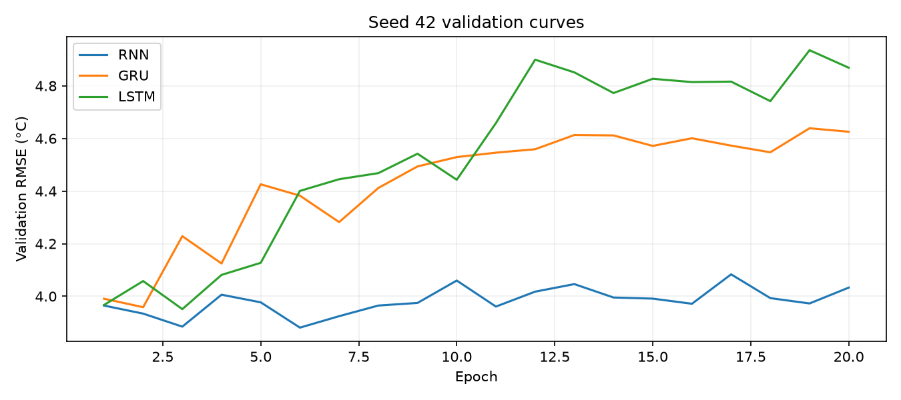
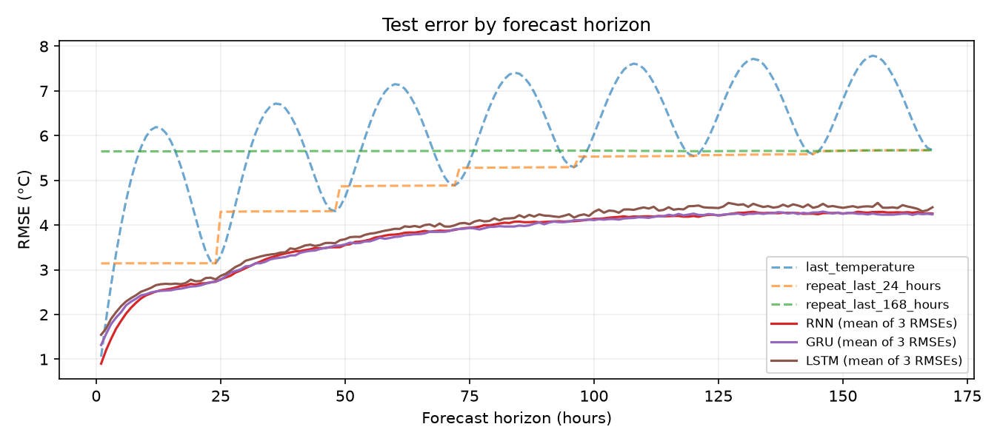
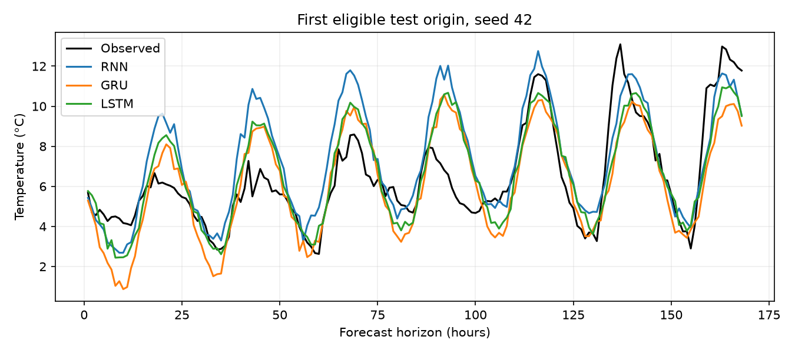

# 气温预测实验：独立测试结果

9 次训练均完成后统一测试，以最低验证 MSE 选取权重。所有模型与基线使用相同的 6269 个滚动预测起点，每个预测 168 小时，共 1053192 个起点—预测步配对。MAE、RMSE 单位均为 °C，越低越好。

| 方法 | MAE（°C） | RMSE（°C） |
|---|---:|---:|
| last_temperature | 4.833 | 6.168 |
| repeat_last_24_hours | 3.887 | 4.987 |
| repeat_last_168_hours | 4.547 | 5.658 |
| RNN（三种子均值 ± 样本标准差） | 2.961 ± 0.033 | 3.787 ± 0.051 |
| GRU（三种子均值 ± 样本标准差） | 2.965 ± 0.009 | 3.774 ± 0.016 |
| LSTM（三种子均值 ± 样本标准差） | 3.077 ± 0.114 | 3.922 ± 0.146 |

标准差描述随机初始化和训练顺序带来的波动，不是置信区间。滚动窗口重叠，同一真实小时可能对应多个预测起点；上述指标按起点—预测步配对等权统计，不能当作 1053192 个独立观测。测试段不足一年，结论不代表所有年份与季节。

| 运行 | 验证最优轮次 | 验证 RMSE | 测试 MAE | 测试 RMSE | 训练+验证秒数 |
|---|---:|---:|---:|---:|---:|
| rnn_s42 | 6 | 3.881 | 2.940 | 3.750 | 39.5 |
| gru_s42 | 2 | 3.959 | 2.955 | 3.769 | 51.6 |
| lstm_s42 | 3 | 3.951 | 2.974 | 3.791 | 52.7 |
| rnn_s43 | 11 | 3.835 | 2.945 | 3.767 | 38.2 |
| gru_s43 | 1 | 3.895 | 2.972 | 3.792 | 50.7 |
| lstm_s43 | 1 | 3.927 | 3.057 | 3.896 | 51.2 |
| rnn_s44 | 17 | 3.857 | 2.999 | 3.845 | 37.6 |
| gru_s44 | 2 | 3.901 | 2.968 | 3.761 | 50.1 |
| lstm_s44 | 1 | 3.991 | 3.199 | 4.079 | 51.2 |

计时只包含每轮训练与验证，不含存盘、下载与进程启动；同隐藏维度不代表同参数量。详细逐小时与逐天误差见 metrics.json，逐窗口预测见同目录 NPZ 文件。

示例固定为测试集第一个可用起点、seed42，没有按误差挑选好看的案例。
